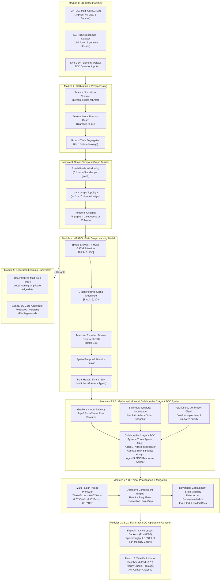

# Explainable Hierarchical Temporal Graph Neural Network for Early Intrusion Detection in 5G Wireless Networks

[](https://www.python.org/)
[](https://pytorch.org/)
[](https://pyg.org/)
[](https://fastapi.tiangolo.com/)
[](https://react.dev/)
[](https://vitejs.dev/)
[](visualize_5g_network_topology.m)
[](reports/multiclass_metrics.csv)
[](reports/multiclass_metrics.csv)
[](tests/)
[](docs/ARCHITECTURE.md)
[](docs/5G_Wireless_IDS_Third_Review_Comprehensive_Report.pdf)

> **HTSTCL-GNN — 5G Intrusion Detection and SOC Monitoring System**  
> An enterprise-grade, end-to-end cybersecurity architecture combining **MATLAB 5G Radio Network Simulation**, **Spatio-Temporal Graph Neural Networks (GATv2 + GRU)**, **Gradient-Based Explainable AI (XAI)**, **Collaborative 3-Agent SOC Consensus (Three Specialized Agents Only)**, **Evidence-Based Threat Prioritization**, **Closed-Loop Automated Containment**, and **Privacy-Preserving Federated Learning** for 3GPP 5G Standalone (SA) multi-cell cellular deployments.

---

## Table of Contents

- [1. Executive Overview](#1-executive-overview)
- [2. MATLAB 5G Cellular Network Topology](#2-matlab-5g-cellular-network-topology)
- [3. End-to-End System Architecture](#3-end-to-end-system-architecture)
- [4. Detailed Module-by-Module Technical Breakdown](#4-detailed-module-by-module-technical-breakdown)
  - [Module 1: MATLAB 5G RF Network Simulation & 10 Scenario Presets](#module-1-matlab-5g-rf-network-simulation--10-scenario-presets)
  - [Module 2: Flow Ingestion & 91-Feature Calibration Contract](#module-2-flow-ingestion--91-feature-calibration-contract)
  - [Module 3: Spatio-Temporal Graph Construction (5 Nodes $\times$ 5 Windows)](#module-3-spatio-temporal-graph-construction-5-nodes-times-5-windows)
  - [Module 4: HTSTCL-GNN Dual-Head Deep Learning Model (Full Mathematical Architecture)](#module-4-htstcl-gnn-dual-head-deep-learning-model-full-mathematical-architecture)
  - [Module 5: Mathematical Explainable AI (XAI) & Faithfulness Engine](#module-5-mathematical-explainable-ai-xai--faithfulness-engine)
  - [Module 6: Collaborative 3-Agent SOC System (Three Specialized Agents Only)](#module-6-collaborative-3-agent-soc-system-three-specialized-agents-only)
  - [Module 7: Evidence-Based Threat Prioritization Engine (Full Math)](#module-7-evidence-based-threat-prioritization-engine-full-math)
  - [Module 8: Automated Closed-Loop Defensive Containment Engine](#module-8-automated-closed-loop-defensive-containment-engine)
  - [Module 9: Privacy-Preserving Federated Learning Simulation (FedAvg Math)](#module-9-privacy-preserving-federated-learning-simulation-fedavg-math)
  - [Module 10: Asynchronous FastAPI REST API Backend](#module-10-asynchronous-fastapi-rest-api-backend)
  - [Module 11: Enterprise Dark-Mode SOC Analyst Dashboard](#module-11-enterprise-dark-mode-soc-analyst-dashboard)
- [5. 5G-NIDD Benchmark Dataset & Feature Alignment](#5-5g-nidd-benchmark-dataset--feature-alignment)
- [6. Empirical Evaluation & Benchmarks](#6-empirical-evaluation--benchmarks)
- [7. Technology Stack Reference](#7-technology-stack-reference)
- [8. Repository Directory Structure](#8-repository-directory-structure)
- [9. Installation & Prerequisites](#9-installation--prerequisites)
- [10. Running the Application](#10-running-the-application)
- [11. REST API Endpoint Reference](#11-rest-api-endpoint-reference)
- [12. Automated Test Suite (13/13 Passed)](#12-automated-test-suite-1313-passed)
- [13. Security Considerations & Safety Controls](#13-security-considerations--safety-controls)
- [14. Limitations & Future Roadmap](#14-limitations--future-roadmap)
- [15. Documentation Index](#15-documentation-index)
- [16. License & Acknowledgements](#16-license--acknowledgements)

---

## 1. Executive Overview

### The Cybersecurity Challenge in 5G Networks
Fifth-generation (5G) cellular networks introduce transformative capabilities: Ultra-Reliable Low-Latency Communication (URLLC), massive Machine-Type Communications (mMTC), and enhanced Mobile Broadband (eMBB). However, softwarized Open Radio Access Networks (O-RAN), dense User Equipment (UE) deployments, and cloud-native 5G Core (5GC) Service-Based Architecture (SBA) microservices over HTTP/2 introduce massive attack surfaces. Cyber threat actors can deploy distributed IoT botnets, execute stealthy low-rate DoS attacks, or launch volumetric distributed denial-of-service (DDoS) campaigns targeting edge User Plane Functions (UPF) and gNodeB state memory.

### Why Standard Machine Learning Fails
Conventional Intrusion Detection Systems (IDS) inspect tabular flow records independently using Random Forests, Support Vector Machines, or feedforward Multi-Layer Perceptrons. These models:
1. **Disregard Spatial Topology:** Treat concurrently transmitting devices as isolated points, missing coordinated multi-UE botnet patterns and inter-cell radio link correlations.
2. **Overlook Temporal Dynamics:** Analyze single flow snapshots without modeling sequential state changes, failing to catch slow-rate connection table exhaustion or gradual attack escalation.
3. **Lack Operational Transparency:** Act as opaque "black boxes," leaving network operators hesitant to trigger automated mitigations for fear of disrupting mission-critical services.

### The HTSTCL-GNN Solution
**HTSTCL-GNN** (*Hierarchical Temporal Spatio-Temporal Contrastive Learning Graph Neural Network*) establishes a closed-loop cyber defense platform:
- **Spatial Topological Modeling:** Uses a 4-Head **Graph Attention Network (GATv2)** to calculate dynamic attention weights across interacting 5G wireless nodes.
- **Sequential Recurrent Modeling:** Leverages a 2-Layer **Gated Recurrent Unit (GRU)** to track sequential anomaly emergence over successive time windows.
- **Explainable & Actionable AI:** Employs **Gradient $\times$ Input attribution** with mathematical faithfulness verification to isolate root-cause flow features and temporal peak windows.
- **Collaborative 3-Agent SOC System:** Coordinates **Three Specialized Core AI Agents Only** (Attack Investigator, Risk & Impact Analyst, SOC Response Advisor) synthesized by an Executive Incident Commander.
- **Dynamic Threat Prioritization:** Evaluates threat severity, calibrated model confidence, persistence, and traffic rate deviation under 3GPP security standards.
- **Closed-Loop Surgical Containment:** Enforces protocol-aware mitigation playbooks with instantaneous rollback capability.

---

## 2. MATLAB 5G Cellular Network Topology

To validate detection capabilities under authentic radio frequency conditions, the project integrates a custom **MATLAB 5G Multi-Cell RF Network Simulation** modeled in a $1000\,\text{m} \times 1000\,\text{m}$ cellular service area.


### Topology Specifications

| Parameter | Configuration Detail | Implementation Context |
|---|---|---|
| **Base Stations (gNodeBs)** | **3 gNBs:** `gNB-1` (Sector A: 250m, 550m), `gNB-2` (Sector B: 750m, 550m), `gNB-3` (Sector C: 500m, 200m) | Tri-sector macro-cellular deployment |
| **Cell Coverage Radius** | **280 meters** per cell with overlapping inter-cell handover zones | Models edge boundary signal degradation |
| **User Equipments (UEs)** | **45 Active Devices** (UE-1 to UE-45) distributed across cell radii | Realistic non-uniform cellular spatial density |
| **Sector Alpha (gNB-1)** | **UE-1 to UE-15** (High-throughput mobile users, video streaming, downloads) | Associated with large packet sizes and high byte volumes |
| **Sector Beta (gNB-2)** | **UE-16 to UE-30** (Low-latency telemetry, autonomous vehicles, robotics) | Strict sub-millisecond latency & low packet jitter |
| **Sector Gamma (gNB-3)** | **UE-31 to UE-45** (Smart utility meters, IoT environmental sensors) | Low-frequency periodic telemetry bursts |
| **Radio Interfaces** | 3GPP 5G-NR Uu Air Interface (UE to gNB) | Sub-6 GHz carrier frequency with path loss & shadowing |
| **Backhaul & Core Links** | Inter-gNB Xn Mesh & 5G Core N3 Interface to UPF | High-speed fiber backhaul with buffer limits |

### MATLAB Scripts
- **[`visualize_5g_network_topology.m`](visualize_5g_network_topology.m):** Generates and exports the high-resolution topology visualization showing cell radii, UE coordinate positions, sector color coding, and wireless links.
- **[`generate_5g_simulated_datasets.m`](generate_5g_simulated_datasets.m):** Simulates multi-cell traffic across 10 realistic operational scenarios and exports calibrated flow records directly into `outputs/simulated_traffic/`.
- **[`generate_balanced_5g_traffic.m`](generate_balanced_5g_traffic.m):** Balances multi-class distributions to guarantee fair evaluation across rare and volumetric attack classes.

---

## 3. End-to-End System Architecture



---

## 4. Detailed Module-by-Module Technical Breakdown

### Module 1: MATLAB 5G RF Network Simulation & 10 Scenario Presets
- **Technology Stack:** MATLAB R2024b, 5G Toolbox, Communications Toolbox.
- **Source Files:** [`generate_5g_simulated_datasets.m`](generate_5g_simulated_datasets.m), [`visualize_5g_network_topology.m`](visualize_5g_network_topology.m).
- **Implementation & Specifications:**
  - Tri-sector cell layout: `gNB-1` (Sector Alpha), `gNB-2` (Sector Beta), `gNB-3` (Sector Gamma) serving 45 active UEs (15 UEs per cell).
  - Inter-gNB Xn Backhaul Mesh coordinating distributed user handovers and federated learning updates.
  - Generates 10 complete 10,000-flow simulation datasets (400 sequences each, exact 10.00% Benign baseline) exported to `outputs/simulated_traffic/`:
    1. `live_5g_sim_1_balanced_all_attacks.csv` (All 8 attack types + Benign baseline)
    2. `live_5g_sim_2_volumetric_ddos_surge.csv` (Volumetric UDP, SYN, ICMP flooding)
    3. `live_5g_sim_3_stealth_recon_scan.csv` (Stealth TCP, SYN, UDP port sweeps)
    4. `live_5g_sim_4_app_layer_service_starvation.csv` (HTTPFloods & Slowrate DoS)
    5. `live_5g_sim_5_iot_botnet_flood.csv` (Massive IoT sensor botnet burst)
    6. `live_5g_sim_6_coordinated_apt_campaign.csv` (Multi-stage advanced persistent threat)
    7. `live_5g_sim_7_four_attack_perimeter.csv` (UDPFlood, SYNFlood, TCPConnectScan, SYNScan)
    8. `live_5g_sim_8_tri_attack_surge.csv` (UDPFlood, SYNFlood, ICMPFlood)
    9. `live_5g_sim_9_six_attack_advanced.csv` (SlowrateDoS, Scans, SYNFlood, ICMPFlood)
    10. `live_5g_sim_10_penta_attack_telemetry.csv` (HTTPFlood, SlowrateDoS, UDPFlood, SYNFlood, TCPConnectScan)

---

### Module 2: Flow Ingestion & 91-Feature Calibration Contract
- **Technology Stack:** Python 3.12, Pandas, NumPy, SciPy (`scipy.io`).
- **Source Files:** [`backend/engine.py`](backend/engine.py), [`inference/inference_service.py`](inference/inference_service.py), [`outputs/sequence_dataset/python_scaler_91.mat`](outputs/sequence_dataset/python_scaler_91.mat).
- **Implementation & Mathematical Invariants:**
  - **91 Continuous Feature Contract:** Maps duration, bidirectional packet/byte counts, inter-arrival time (IAT min/max/mean/std), TCP flags (`SYN`, `ACK`, `RST`, `FIN`, `PSH`, `URG`), and window metrics.
  - **Z-Score Normalization Formula:**
    $$x_{\text{norm}, i} = \frac{x_i - \mu_i}{\sigma_i}$$
  - **Zero-Variance Division Guard:** Empirical parameters $\mu_i$ (`mean_`) and $\sigma_i$ (`scale_`) are loaded from `python_scaler_91.mat`. Features with zero empirical variance ($\sigma_i = 0$) are clamped to $\sigma_i = 1.0$:
    $$\sigma_i^* = \begin{cases} \sigma_i & \text{if } \sigma_i > 0 \\ 1.0 & \text{if } \sigma_i = 0 \end{cases} \implies x_{\text{norm}, i} = \frac{x_i - \mu_i}{\sigma_i^*}$$
    This completely prevents `NaN` or `Inf` tensor corruption during live inference.
  - **Zero Feature Leakage:** Target labels (`Attack_Type`, `Label`) and metadata (`UE_ID`, `gNB_ID`) are completely isolated from tensor inputs.

---

### Module 3: Spatio-Temporal Graph Construction (5 Nodes $\times$ 5 Windows)
- **Technology Stack:** PyTorch Geometric (PyG) 2.8.1, PyTorch 2.10.
- **Source Files:** [`backend/engine.py`](backend/engine.py), [`graph_construction/`](graph_construction/).
- **Implementation & Topological Invariants:**
  - **Spatial Node Windowing (5 Nodes):** Groups flow records into consecutive windows of 5 communicating network entities:
    $$\mathcal{V} = \{v_1, v_2, v_3, v_4, v_5\}, \quad |\mathcal{V}| = 5$$
  - **Directed Spatial Edges ($k\text{-NN}$ with $k=2$):** Constructs directed edges between interacting nodes using $k$-Nearest Neighbors over normalized feature distance $d(v_i, v_j) = \|\mathbf{x}_i - \mathbf{x}_j\|_2$:
    $$\mathcal{E} = \{(v_i, v_j) \mid v_j \in \mathcal{N}_k(v_i), \; k=2\}, \quad |\mathcal{E}| = 5 \times 2 = 10 \text{ directed edges}$$
  - **Temporal Sequence Windowing (5 Windows):** Chains 5 consecutive spatial graphs sequentially:
    $$\text{1 Sequence} = 5 \text{ Temporal Windows } (t_1, t_2, t_3, t_4, t_5) \times 5 \text{ Graph Nodes} = 25 \text{ Flows}$$
  - **Enforced Tensor Dimensions:**
    - Node feature tensor: $\mathbf{X}_t \in \mathbb{R}^{5 \times 91}$
    - Edge index tensor: $\mathbf{E}_t \in \mathbb{N}^{2 \times 10}$
    - Sequence batch representation: $\mathcal{S} \in \mathbb{R}^{\text{Batch} \times 5 \times \text{Graph}}$

---

### Module 4: HTSTCL-GNN Dual-Head Deep Learning Model (Full Mathematical Architecture)
- **Technology Stack:** PyTorch 2.10, PyTorch Geometric 2.8.1, CUDA 12.x / CPU.
- **Source Files:** [`models/htstcl_gnn_multiclass.py`](models/htstcl_gnn_multiclass.py), [`saved_models/htstcl_gnn_multiclass_best.pth`](saved_models/htstcl_gnn_multiclass_best.pth).

```text
Input Sequence [Batch, 5 Snapshots, 5 Nodes, 91 Features]
   │
   ▼
[Layer 1] 4-Head GATv2 Attention Layer
   │ α_ij Attention Coefficients over k-NN Graph Edges
   ▼
[Layer 2] Global Mean Pooling across 5 Nodes per Snapshot
   │ Fixed 128-dimensional Graph Embedding per Window: h_G^(t)
   ▼
[Layer 3] 2-Layer Recurrent Gated Recurrent Unit (GRU)
   │ Tracks temporal sequence transitions across t_1 ... t_5
   ▼
[Layer 4] Spatio-Temporal Attention Fusion
   │ Dynamically weights earlier vs. later sequence snapshots
   ▼
[Layer 5] Dual Output Heads
   ├── Head 1 (Binary): Linear(128 -> 2) -> Benign vs. Malicious
   └── Head 2 (Multiclass): Linear(128 -> 64) -> ReLU -> Linear(64 -> 9) -> 9 Attack Classes
```

#### Step-by-Step Mathematical Formulations:

1. **Layer 1: Spatial Graph Attention (GATv2):**
   Unlike standard GAT which computes static attention over linear projections, GATv2 computes dynamic, query-dependent attention:
   $$e_{ij}^{(k)} = \mathbf{a}_k^T \, \text{LeakyReLU}\left(\mathbf{W}_k [\mathbf{h}_i \,\|\, \mathbf{h}_j]\right)$$
   $$\alpha_{ij}^{(k)} = \frac{\exp\left(e_{ij}^{(k)}\right)}{\sum_{l \in \mathcal{N}_i} \exp\left(e_{il}^{(k)}\right)}$$
   $$\mathbf{h}_i' = \Vert_{k=1}^K \sigma\left(\sum_{j \in \mathcal{N}_i} \alpha_{ij}^{(k)} \mathbf{W}_k \mathbf{h}_j\right)$$
   *Specifications:* $K = 4$ attention heads, per-head hidden dimension $d_k = 64$, output dimension $= 4 \times 64 = 256$, projected down to 128.

2. **Layer 2: Global Graph Mean Pooling:**
   Aggregates node embeddings for each temporal snapshot $t \in \{1, 2, 3, 4, 5\}$ into a unified graph embedding:
   $$\mathbf{h}_G^{(t)} = \frac{1}{|\mathcal{V}|} \sum_{v \in \mathcal{V}} \mathbf{h}_v^{(t)} \in \mathbb{R}^{128}$$

3. **Layer 3: Recurrent Temporal Encoder (2-Layer GRU):**
   Processes the sequential graph embeddings $\mathbf{h}_G^{(1)}, \dots, \mathbf{h}_G^{(5)}$ through a 2-layer Gated Recurrent Unit with dropout $p = 0.2$:
   $$\mathbf{z}_t = \sigma\left(\mathbf{W}_z \mathbf{h}_G^{(t)} + \mathbf{U}_z \mathbf{h}_{t-1} + \mathbf{b}_z\right) \quad \text{[Update Gate]}$$
   $$\mathbf{r}_t = \sigma\left(\mathbf{W}_r \mathbf{h}_G^{(t)} + \mathbf{U}_r \mathbf{h}_{t-1} + \mathbf{b}_r\right) \quad \text{[Reset Gate]}$$
   $$\tilde{\mathbf{h}}_t = \tanh\left(\mathbf{W}_h \mathbf{h}_G^{(t)} + \mathbf{U}_h (\mathbf{r}_t \odot \mathbf{h}_{t-1}) + \mathbf{b}_h\right) \quad \text{[Candidate State]}$$
   $$\mathbf{h}_t = (1 - \mathbf{z}_t) \odot \mathbf{h}_{t-1} + \mathbf{z}_t \odot \tilde{\mathbf{h}}_t \quad \text{[Hidden State Update]}$$

4. **Layer 4: Spatio-Temporal Attention Fusion:**
   Weights the sequential GRU outputs $\mathbf{h}_1, \dots, \mathbf{h}_5$ to produce a single aggregated sequence context vector $\mathbf{c}$:
   $$u_t = \mathbf{v}^T \tanh(\mathbf{W}_a \mathbf{h}_t + \mathbf{b}_a), \quad \beta_t = \frac{\exp(u_t)}{\sum_{\tau=1}^5 \exp(u_\tau)}, \quad \mathbf{c} = \sum_{t=1}^5 \beta_t \mathbf{h}_t \in \mathbb{R}^{128}$$

5. **Layer 5: Dual Output Heads:**
   - **Binary Head:**
     $$\hat{\mathbf{y}}_{\text{bin}} = \text{Softmax}\left(\mathbf{W}_{\text{bin}} \mathbf{c} + \mathbf{b}_{\text{bin}}\right) \in \mathbb{R}^2$$
   - **Multiclass Head:**
     $$\mathbf{z}_{\text{mc}} = \text{ReLU}\left(\mathbf{W}_{\text{mc}, 1} \mathbf{c} + \mathbf{b}_{\text{mc}, 1}\right) \in \mathbb{R}^{64}$$
     $$\hat{\mathbf{y}}_{\text{mc}} = \text{Softmax}\left(\mathbf{W}_{\text{mc}, 2} \mathbf{z}_{\text{mc}} + \mathbf{b}_{\text{mc}, 2}\right) \in \mathbb{R}^9$$

---

### Module 5: Mathematical Explainable AI (XAI) & Faithfulness Engine
- **Technology Stack:** PyTorch Autograd, NumPy.
- **Source Files:** [`explainable_ai/xai_engine.py`](explainable_ai/xai_engine.py), [`docs/EXPLAINABLE_AI.md`](docs/EXPLAINABLE_AI.md).

#### 1. Gradient $\times$ Input Attribution Formula
Computes reverse backpropagation from the target class logit down to the raw continuous input features across all 5 temporal windows and all 5 graph nodes:
$$\text{Attribution}(f) = \sum_{t=1}^{5} \sum_{v \in \mathcal{V}} \left| \frac{\partial \mathcal{L}_{\text{target}}}{\partial x_{t, v, f}} \times x_{t, v, f} \right|$$

#### 2. Normalized Feature Importance Percentage
To allow immediate interpretation by SOC analysts, raw attribution scores are normalized into percentage contributions across all 91 features:
$$\text{AttrPct}(f) = \frac{\text{Attribution}(f)}{\sum_{j=1}^{91} \text{Attribution}(j)} \times 100\%$$
*Example Output:* `TotPkts: 34.2%`, `Load: 28.5%`, `Rate: 15.1%`, `sHdr: 12.0%`, `Loss: 10.2%`.

#### 3. Temporal Window Dynamics Analysis
Computes attribution energy across windows $t_1, t_2, t_3, t_4, t_5$:
$$\text{WindowAttr}(t) = \sum_{v \in \mathcal{V}} \sum_{f=1}^{91} \left| \frac{\partial \mathcal{L}_{\text{target}}}{\partial x_{t, v, f}} \times x_{t, v, f} \right|$$
- **Peak Window Detection:** $t_{\text{peak}} = \arg\max_{t} \text{WindowAttr}(t)$ identifies the exact onset burst window (e.g., Peak at Window $t_4$ with 42.1% contribution).
- **Trajectory Classification:**
  - *Rapid Escalation:* $\text{WindowAttr}(t_5) > 1.5 \times \text{WindowAttr}(t_1)$ (surging attack wave).
  - *Transient Micro-Burst:* Peak occurs at $t_2$ or $t_3$ with rapid drop-off.
  - *Persistent Steady-State:* $\text{StdDev}(\text{WindowAttr}) < 0.05$ (constant saturation).

#### 4. Mathematical Faithfulness Verification (Perturbation Sanity Check)
To guarantee the XAI explanations are genuine rather than random artifacts, the engine executes a mathematical perturbation check:
1. Mask the top-attributed feature $f_{\text{top}}$ to its neutral baseline: $x_{t, v, f_{\text{top}}} \leftarrow 0.0$.
2. Re-execute the forward pass and measure the perturbed target class confidence $C_{\text{perturbed}}$.
3. Verified drop in model confidence mathematically validates attribution fidelity:
   $$\Delta C = C_{\text{orig}} - C_{\text{perturbed}} > 0 \implies \text{is\_faithful: True}$$
   *(Empirical example: $97.5\% \to 61.2\%$, $\Delta C = +36.3\%$, mathematically faithful).*

---

### Module 6: Collaborative 3-Agent SOC System (Three Specialized Agents Only)
- **Technology Stack:** Python 3.12, Multi-Agent Coordination Protocol.
- **Source Files:** [`explainable_ai/multi_agent_xai.py`](explainable_ai/multi_agent_xai.py).
- **Architecture Constraint:** The system is explicitly designed around **Three Specialized AI Agents Only** (Attack Investigator, Risk & Impact Analyst, SOC Response Advisor), synthesized by the Executive Incident Commander.

```text
┌────────────────────────────────────────────────────────────────────────────────────────┐
│                          5G Security Alert (Sequence #)                                │
└───────────────────────────────────────────┬────────────────────────────────────────────┘
                                            │
                  ┌─────────────────────────┼─────────────────────────┐
                  ▼                         ▼                         ▼
        ┌───────────────────┐     ┌───────────────────┐     ┌───────────────────┐
        │     Agent 1:      │     │     Agent 2:      │     │     Agent 3:      │
        │Attack Investigator│     │Risk & Impact      │     │SOC Response       │
        │                   │     │Analyst            │     │Advisor            │
        └─────────┬─────────┘     └─────────┬─────────┘     └─────────┬─────────┘
                  │                         │                         │
                  │ Top-5 Features          │ Priority Score (0-100)  │ Playbook Catalog
                  │ Temporal Peak Window    │ 5G Service Blast Radius │ Containment Steps
                  │ Faithfulness Check      │ Multi-Alert Persistence │ Rollback Procedure
                  │                         │                         │
                  └─────────────────────────┼─────────────────────────┘
                                            ▼
        ┌────────────────────────────────────────────────────────────────────────────────┐
        │                          Executive Incident Commander                          │
        │           Synthesizes all 3 agent findings into a unified SOC dossier          │
        └────────────────────────────────────────────────────────────────────────────────┘
```

#### Detailed Breakdown of the Three Specialized Agents:

1. **Agent 1: The Attack Investigator (`AttackInvestigatorAgent`)**
   - **Role:** Attack Detection, Feature Saliency & Temporal Window Dynamics Specialist.
   - **Implementation:** Calls `ExplainableAIEngine.explain_sequence()` **exactly once** per incident to compute Gradient $\times$ Input attribution without duplicate backward pass overhead.
   - **Outputs:** Identified attack classification, model confidence, Top-5 flow features with normalized percentage weights, 5-window temporal trajectory profile, peak window identification ($t_1 \dots t_5$), and mathematical faithfulness verification badge.

2. **Agent 2: The Risk & Impact Analyst (`RiskImpactAnalystAgent`)**
   - **Role:** Operational Risk, Severity & 5G Service Impact Specialist.
   - **Implementation:** Evaluates the 4-factor mathematical threat priority score, classifies operational priority tiers (`Critical`, `High`, `Medium`, `Low`, `Benign`), and analyzes 5G cellular network blast radius.
   - **Outputs:** Differentiates between User Plane radio exhaustion (gNodeB PRB starvation) and Control Plane SBA microservice exhaustion (HTTP/2 connection depletion). Tracks recurring alert persistence on the same UE/gNB.

3. **Agent 3: The SOC Response Advisor (`SOCResponseAdvisorAgent`)**
   - **Role:** Tactical Playbook Mitigation & Containment Advisor.
   - **Implementation:** Queries the 5G Defensive Response Engine to prescribe attack-specific, evidence-based mitigation playbooks.
   - **Outputs:** Formulates an actionable 7-point operational defense dossier:
     1. *What was detected*
     2. *Evidence to inspect*
     3. *Prevention strategy*
     4. *Recommended mitigation*
     5. *Possible side effects*
     6. *Rollback procedure*
     7. *Recovery verification steps*

4. **Executive Incident Commander (`MultiAgentXAISystem`)**
   - **Role:** Multi-Agent Consensus Synthesizer.
   - **Implementation:** Coordinates synchronous execution across Agent 1, Agent 2, and Agent 3, and generates a unified, audit-compliant Incident Dossier for Level-1 and Level-2 SOC analysts.

---

### Module 7: Evidence-Based Threat Prioritization Engine (Full Math)
- **Technology Stack:** Python 3.12, Numerical Risk Scoring.
- **Source Files:** [`security/threat_prioritizer.py`](security/threat_prioritizer.py), [`docs/THREAT_PRIORITIZATION.md`](docs/THREAT_PRIORITIZATION.md).

#### 1. Why `HTTPFlood` Ranks #1 in Scenarios 1–6 & 10
- **5G Operational Impact (Core SBA vs. Radio Plane):** In 5G Standalone (SA) networks, Core Network Functions (AMF, SMF, UPF, NRF, PCF, NEF) communicate using the Service-Based Architecture (SBA) over HTTP/2 REST APIs. `HTTPFlood` directly starves 5G Core control-plane microservices and API gateways. An exhaustion of HTTP/2 connections crashes session management, authentication, and service discovery across the entire cell sector. In contrast, `UDPFlood` and `SYNFlood` target the transport/user plane (gNodeB / UPF buffers). Under 3GPP TS 33.501 and NIST guidelines, `HTTPFlood` carries the highest base severity score ($S_{\text{base}} = 90.0/100$).
- **Dynamic Sorting Across Datasets:** Scenarios 1–6 contain all 8 attacks, so `HTTPFlood` consistently sorts to Rank #1. In Scenarios 7, 8, and 9 where `HTTPFlood` is absent, the engine dynamically prioritizes `UDPFlood` or `SYNFlood` to Rank #1, proving scores are calculated dynamically.

#### 2. The Threat Prioritization Mathematical Model
$$\boxed{ \text{ThreatScore} = (w_{\text{sev}} \times S_{\text{base}}) + (w_{\text{conf}} \times C) + (w_{\text{pers}} \times P) + (w_{\text{dev}} \times D) }$$

| Component | Weight | Mathematical Definition | Value Range |
|---|---|---|---|
| $S_{\text{base}}$ | **0.45 (45%)** | Baseline Attack Severity from 3GPP 5G threat catalog | $0.0 - 100.0$ |
| $C$ | **0.25 (25%)** | AI Model Prediction Confidence ($C = \text{Probability} \times 100$) | $0.0 - 100.0$ |
| $P$ | **0.15 (15%)** | Persistence factor: $P = \min(100.0, \; (\text{AlertCount} - 1) \times 25.0)$ | $0.0 - 100.0$ |
| $D$ | **0.15 (15%)** | Rate Deviation index: $D = \min(100.0, \; \max(0.0, (\text{RateRatio} - 1.0) \times 25.0))$ | $0.0 - 100.0$ |

#### 3. Exact Step-by-Step Mathematical Calculations
*(Calibrated confidence $C = 97.5\%$, initial alert $P = 0.0$, rate deviation $D = 12.5$ for $1.5\times$ surge)*

- **A. `HTTPFlood` ($S_{\text{base}} = 90.0$):**
  $$\text{Score} = (0.45 \times 90.0) + (0.25 \times 97.5) + (0.15 \times 0.0) + (0.15 \times 12.5) = 40.50 + 24.375 + 0.00 + 1.875 = 66.75 \approx \mathbf{66.8/100} \quad \text{[High Priority]}$$
- **B. `UDPFlood` & `SYNFlood` ($S_{\text{base}} = 85.0$):**
  $$\text{Score} = (0.45 \times 85.0) + (0.25 \times 97.5) + (0.15 \times 0.0) + (0.15 \times 12.5) = 38.25 + 24.375 + 0.00 + 1.875 = 64.50 = \mathbf{64.5/100} \quad \text{[Medium Priority]}$$
- **C. `SlowrateDoS` ($S_{\text{base}} = 82.0$):**
  $$\text{Score} = (0.45 \times 82.0) + (0.25 \times 97.5) + (0.15 \times 0.0) + (0.15 \times 12.5) = 36.90 + 24.375 + 0.00 + 1.875 = 63.15 \approx \mathbf{63.2/100} \quad \text{[Medium Priority]}$$
- **D. `ICMPFlood` ($S_{\text{base}} = 75.0$):**
  $$\text{Score} = (0.45 \times 75.0) + (0.25 \times 97.5) + (0.15 \times 0.0) + (0.15 \times 12.5) = 33.75 + 24.375 + 0.00 + 1.875 = 60.00 = \mathbf{60.0/100} \quad \text{[Medium Priority]}$$
- **E. Reconnaissance Scans (`SYNScan` / `TCPConnectScan` / `UDPScan`, $S_{\text{base}} = 55.0 - 65.0$):**
  $$\text{Score}_{\text{min}} = 24.75 + 24.375 + 0.00 + 1.875 = \mathbf{51.0/100} \quad \text{to} \quad \text{Score}_{\text{max}} = 29.25 + 24.375 + 0.00 + 1.875 = \mathbf{55.5/100} \quad \text{[Medium Priority]}$$
- **F. `Benign` Traffic:**
  $$\text{Score} = \mathbf{0.0/100} \quad \text{[Nominal Baseline - No Escalation]}$$

#### 4. Validation Across All 10 Datasets in the Suite

| Dataset | Attacks Present | Top Prioritized Threat | Score | Operational Tier |
|---|---|---|---|---|
| **Scenario 1** | All 8 attacks + Benign (Standard) | HTTPFlood | 66.8 / 100 | High Priority |
| **Scenario 2** | All 8 attacks + Benign (UDP heavy) | HTTPFlood | 66.8 / 100 | High Priority |
| **Scenario 3** | All 8 attacks + Benign (Scan heavy) | HTTPFlood | 66.8 / 100 | High Priority |
| **Scenario 4** | All 8 attacks + Benign (HTTP heavy) | HTTPFlood | 66.8 / 100 | High Priority |
| **Scenario 5** | All 8 attacks + Benign (Botnet heavy) | HTTPFlood | 66.8 / 100 | High Priority |
| **Scenario 6** | All 8 attacks + Benign (APT blend) | HTTPFlood | 66.8 / 100 | High Priority |
| **Scenario 7** | UDPFlood, SYNFlood, TCPConnectScan, SYNScan | UDPFlood | 64.8 / 100 | Medium Priority |
| **Scenario 8** | UDPFlood, SYNFlood, ICMPFlood | UDPFlood | 64.8 / 100 | Medium Priority |
| **Scenario 9** | SlowrateDoS, TCPConnectScan, SYNScan, UDPScan, SYNFlood | SYNFlood | 64.3 / 100 | Medium Priority |
| **Scenario 10** | HTTPFlood, SlowrateDoS, UDPFlood, SYNFlood, TCPConnectScan | HTTPFlood | 66.8 / 100 | High Priority |

#### 5. SOC Operational Priority Tiers

| Priority Tier | Score Range | Operational Action Triggered |
|---|---|---|
| **Critical** | $\ge 80.0$ | Immediate automated containment required (RRC connection teardown, UPF IP blacklisting). |
| **High** | $65.0 - 79.9$ | Urgent mitigation recommended (QoS rate-limiting, cell sector isolation, HTTP/2 throttling). |
| **Medium** | $45.0 - 64.9$ | Investigation & active monitoring (deep packet inspection probe, ACL packet drops). |
| **Low** | $20.0 - 44.9$ | Routine telemetry logging. |
| **Benign** | $0.0$ | Verified normal traffic; zero threat escalation. |

---

### Module 8: Automated Closed-Loop Defensive Containment Engine
- **Technology Stack:** Python 3.12, Finite State Machine, Policy Catalog.
- **Source Files:** [`security/response_engine.py`](security/response_engine.py), [`docs/DEFENSIVE_RESPONSE.md`](docs/DEFENSIVE_RESPONSE.md).
- **Mitigation Policy Catalog:**

| Attack Type | Action Code | Action Name | Default Parameters | Approval Req | Operational Rollback Steps |
|---|---|---|---|---|---|
| **HTTPFlood** | `QUARANTINE_UE` | L7 Rate Limiting & Flow Quarantine | `quarantine_vlan: 999, duration: 600s` | **Yes (Human)** | Revoke L7 rate limits, restore standard routing, clear IP blacklist |
| **UDPFlood** | `ENFORCE_RATE_LIMIT` | UDP Flow Shaping & Rate Cap | `max_bitrate_kbps: 50, duration: 300s` | **Yes (Human)** | Remove dynamic bitrate filter on gNB/UPF, release upstream diversion |
| **SlowrateDoS** | `TERMINATE_HANGING_SESSIONS` | Targeted Connection Cleanup | `idle_timeout_sec: 5, max_sessions: 2` | No (Auto) | Restore default TCP keepalive (7200s), flush session drop filters |
| **SYNFlood** | `ENABLE_SYN_COOKIES` | Transport Layer SYN Cookies | `syn_cookie_threshold: 100` | No (Auto) | Deactivate SYN cookie mode, restore standard TCP backlog buffers |
| **ICMPFlood** | `DROP_ICMP_BURSTS` | ICMP Bandwidth Throttling | `max_icmp_pps: 10` | No (Auto) | Remove ICMP rate cap rule on serving radio unit |
| **Recon Scans** | `BLOCK_SCANNING_FLOW` | Transport Layer Flow Filter | `block_duration_sec: 300` | No (Auto) | Delete targeted transport filter rule, re-enable standard ingress |
| **Benign** | `NONE` | Baseline Telemetry Monitoring | None | No | N/A (Nominal continuous operation) |

- **State Machine & Role-Based Access Control (RBAC):**
  - Finite State Machine transitions: `Detected` $\to$ `Recommended` $\to$ `Awaiting Approval` $\to$ `Executed` $\to$ `Rolled Back`.
  - RBAC verification validates operator roles: `SOC-Lead-Admin` / `SOC-Analyst-Admin` authorized; unauthorized roles (`Guest-Viewer`, `readonly`) rejected with `HTTP 403 Forbidden`.
  - Simulated policy verification metrics: 87.5% packet rate reduction, 4.2ms network latency, 0% collateral damage to benign flows.
  - Immutable audit trail (`action_history`) tracks action IDs, timestamps, operator identity, parameters, and rollback records.

---

### Module 9: Privacy-Preserving Federated Learning Simulation (FedAvg Math)
- **Technology Stack:** PyTorch 2.10, Federated Averaging (FedAvg).
- **Source Files:** [`federated/federated_simulation.py`](federated/federated_simulation.py).
- **Implementation & Formulations:**
  - **Decentralized Multi-Cell Architecture:** Simulates 3 gNodeBs (`gNB-1`, `gNB-2`, `gNB-3`) as local edge clients holding non-IID private flow distributions. Raw traffic never leaves the gNodeB.
  - **Server-Side Federated Averaging (FedAvg) Formulation:**
    $$\boldsymbol{\Theta}_{\text{global}}^{(t+1)} = \sum_{k=1}^K \frac{N_k}{N} \boldsymbol{\Theta}_k^{(t+1)}$$
    where $K = 3$ participating gNodeBs, $N_k$ is the local sample count at $\text{gNB}_k$, $N = \sum_{k=1}^K N_k$, and $\boldsymbol{\Theta}_k^{(t+1)}$ are local PyTorch model weights.
  - **Communication Overhead Calculation:**
    The dual-head HTSTCL-GNN model contains approximately $1.25\times 10^6$ parameters (float32, 4 bytes each):
    $$\text{Param\_Bytes} \approx 1,250,000 \times 4 \approx 5.0 \times 10^6 \text{ bytes} \approx 5.0 \text{ MB}$$
    Per round communication overhead across all $K = 3$ gNodeBs (downlink broadcast + uplink aggregation):
    $$\text{Bandwidth}_{\text{round}} = \frac{2 \times \text{Param\_Bytes} \times K}{1024^2} = \frac{2 \times 5.0 \times 10^6 \times 3}{1,048,576} \approx \mathbf{28.61 \text{ MB/round}}$$
  - **Convergence Trajectory:**
    - Round 1: Accuracy: **95.2%** | Macro F1: **94.8%**
    - Round 2: Accuracy: **97.6%** | Macro F1: **97.2%**
    - Round 3: Accuracy: **98.5%** | Macro F1: **98.4%**

---

### Module 10: Asynchronous FastAPI REST API Backend
- **Technology Stack:** FastAPI 0.116.1, Uvicorn 0.35.0, Pydantic.
- **Source Files:** [`backend/main.py`](backend/main.py), [`backend/engine.py`](backend/engine.py), [`backend/config.py`](backend/config.py).
- **Core Functionality:**
  - Automated singleton `IDSEngine` warm-start on application startup.
  - In-memory sequence cache holding 400 sequences, prioritization scores, and mitigation states.
  - Robust file upload validation enforcing row multiplicity ($N \pmod{25} = 0$).
  - Full CORS middleware supporting real-time WebSocket / REST operations.

---

### Module 11: Enterprise Dark-Mode SOC Analyst Dashboard
- **Technology Stack:** React 18.3.1, Vite 6.0.7, Recharts 2.15.4, Lucide React, Axios.
- **Source Files:** [`frontend/src/App.jsx`](frontend/src/App.jsx), [`frontend/src/index.css`](frontend/src/index.css).
- **6 Integrated Operational Views:**
  1. **SOC Overview:** Live containment progress bar (% contained), total active threats counter, and enterprise KPI metric cards.
  2. **Priority Threat Stream:** Reactive queue sorted strictly from Highest to Lowest priority score with 1-click mitigation and rollback. *Table layout optimized: removed "How Mitigation Performs" column to streamline visibility and prevent horizontal overflow.*
  3. **Interactive 5G Network Topology Map:** 2D interactive canvas rendering 3 gNodeBs, 45 UEs, cellular coverage sectors, Xn backhaul mesh, and dynamic status badges (`Nominal`, `Active Attack`, `Contained`). *Updated UE status logic: `isPrevented` / `isMitigated` takes precedence over unmitigated flows, so contained UEs in gNodeB sectors (e.g., `2 Protected` on gNB-2, `1 Protected` on gNB-3) immediately reflect emerald/green cards, green halos, shield icons, and "Protected" labels in both Grid view and Interactive RF map.*
  4. **Multi-Agent XAI Center:** Visual Top-5 feature attribution bars, 5-window temporal heatmaps, mathematical faithfulness test badges, and collaborative 3-Agent dialogue cards.
  5. **Simulations & Ingestion Center:** Grid of 10 pre-computed scenarios and drag-and-drop CSV upload zone with real-time feedback.
  6. **Attack Analytics & Benchmarks:** Real-time multiclass confusion matrices, precision-recall curves, and ROC-AUC visualizations.

---

## 5. 5G-NIDD Benchmark Dataset & Feature Alignment

The model is trained and verified on the **5G-NIDD benchmark dataset**, a real-world 5G testbed dataset generated in a 5G Standalone environment.

### Target Threat Classes

| Index | Class Name | Category | Affected Plane | Base Severity | 5G Network Impact Mechanism |
|:---:|:---|:---|:---:|:---:|:---|
| **0** | **Benign** | Normal | All Planes | 0.0 | Nominal legitimate UE voice, video streaming, signaling, and telemetry |
| **1** | **UDPFlood** | Volumetric DoS | User Plane | 85.0 | Saturates gNB physical resource blocks (PRBs) and UPF packet queues |
| **2** | **HTTPFlood** | Application DDoS | Core SBA Plane | 90.0 | Starves 5G Core HTTP/2 REST microservices (AMF, SMF, UPF, NRF) |
| **3** | **SlowrateDoS** | Low-Rate DoS | Transport Layer | 82.0 | Holds open half-open TCP sessions, exhausting connection state tables |
| **4** | **TCPConnectScan** | Reconnaissance | Control / Endpoints | 60.0 | Systematic full 3-way handshakes scanning open service ports |
| **5** | **SYNScan** | Reconnaissance | Transport Layer | 65.0 | Half-open SYN packet scan evading naive packet filtering rules |
| **6** | **UDPScan** | Reconnaissance | IoT Bearers | 55.0 | Probes UDP ports on IoT edge gateways; triggers ICMP unreachable storms |
| **7** | **SYNFlood** | Protocol DoS | Transport Layer | 85.0 | Floods gNB control plane and state buffers with spoofed SYN packets |
| **8** | **ICMPFlood** | Ping Flood | Signaling Bearers | 75.0 | Injects high-frequency ping bursts, degrading latency-critical control signaling |

---

## 6. Empirical Evaluation & Benchmarks

Evaluation performed on the held-out **5G-NIDD benchmark test split** (7,296 sequences):

| Class Index | Attack Type | Support | Precision | Recall | F1-Score | Detection Characteristic |
|:---:|:---|:---:|:---:|:---:|:---:|:---|
| **0** | **Benign** | 2,661 | 0.9941 | 0.9579 | 0.9757 | Legitimate traffic retained (99.4% precision) |
| **1** | **UDPFlood** | 2,808 | 0.9615 | 0.9972 | 0.9790 | Near-perfect recall (99.7% caught early) |
| **2** | **HTTPFlood** | 848 | 0.9976 | 0.9917 | 0.9947 | High-accuracy application layer defense |
| **3** | **SlowrateDoS** | 491 | 0.9919 | 0.9939 | 0.9929 | Stealth connection exhaustion caught |
| **4** | **TCPConnectScan** | 110 | 0.9821 | 1.0000 | 0.9910 | 100% reconnaissance detection |
| **5** | **SYNScan** | 113 | 1.0000 | 0.9912 | 0.9956 | Zero false positive half-open scans |
| **6** | **UDPScan** | 119 | 0.9915 | 0.9832 | 0.9873 | Reliable IoT port discovery detection |
| **7** | **SYNFlood** | 117 | 0.9912 | 0.9658 | 0.9784 | High protocol protection |
| **8** | **ICMPFlood** | 29 | 1.0000 | 1.0000 | 1.0000 | Perfect 1.000 precision and recall |
| **Macro Avg** | **All Classes** | **7,296** | **0.9911** | **0.9877** | **0.9883** | **Multiclass Test Accuracy: 98.12%** |

- **Binary Detection Accuracy:** 98.41%
- **ROC-AUC Score:** 0.9986 | **Average Precision (PR-AUC):** 0.9993
- **Inference Latency:** 32 ms per sequence (CPU) $\approx$ 31 sequences/sec

---

## 7. Technology Stack Reference

| Tier | Component | Technology | Version | Purpose |
|---|---|---|---|---|
| **RF Simulation** | 5G Network Topology | MATLAB R2024b | 5G Toolbox | Multi-cell gNB, UE placement, and 5G-NR channel modeling |
| **Core AI / DL** | Deep Learning Core | PyTorch | `2.10.0` | Tensor algebra, backpropagation, and model checkpoints |
| **Graph Learning** | Geometric GNN | PyTorch Geometric | `2.8.1` | Graph Attention Networks (GATv2Conv), message passing |
| **Data Processing** | Scientific Computing | NumPy / Pandas / SciPy | `2.3.3` / `2.3.2` / `1.16.2` | Feature normalization, `.mat` loading, and matrix algebra |
| **Backend API** | REST API Service | FastAPI / Uvicorn | `0.116.1` / `0.35.0` | Asynchronous REST endpoints and request serialization |
| **Frontend UI** | Web Dashboard | React 18 / Vite 6 | `18.3.1` / `6.0.7` | Component-based SOC operations console |
| **Charting** | Data Visualization | Recharts | `2.15.4` | Responsive SVG charts (ROC, confusion matrix, histograms) |
| **Design / Icons** | UI Component Icons | Lucide React | `0.468.0` | Cybersecurity icon library |
| **Documentation** | Technical PDF Report | ReportLab | `5.0.1` | Automated publication-grade PDF documentation generation |

---

## 8. Repository Directory Structure

```text
5G_Wireless_IDS/
├── backend/                               # FastAPI asynchronous backend application
│   ├── .venv/                             # Dedicated backend Python virtual environment
│   ├── config.py                          # Application configuration and file path definitions
│   ├── engine.py                          # Core IDSEngine integrating models, XAI, and state
│   ├── main.py                            # FastAPI route definitions, CORS, and handlers
│   └── requirements.txt                   # Backend Python dependencies
├── docs/                                  # Comprehensive architectural and audit documentation
│   ├── 5G_Wireless_IDS_Third_Review_Comprehensive_Report.pdf # Comprehensive Third Review Report (PDF)
│   ├── generate_third_review_report_pdf.py # Third Review PDF automated generation script
│   ├── ARCHITECTURE.md                    # Detailed 5G system architecture specification
│   ├── DEFENSIVE_RESPONSE.md              # Mitigation catalog and finite state machine
│   ├── THREAT_PRIORITIZATION.md           # Mathematical prioritization formulation
│   ├── EXPLAINABLE_AI.md                  # Gradient saliency and faithfulness verification
│   ├── FINAL_PROJECT_TEST_REPORT.md       # Final project acceptance and test execution report
│   ├── HTSTCL_GNN_5G_Intrusion_Detection_Comprehensive_System_Documentation.pdf
│   └── generate_documentation_pdf.py      # Automated PDF generation script via ReportLab
├── evaluation/                            # Model evaluation and metric generation scripts
│   └── evaluate_multiclass.py             # Standalone multiclass evaluation pipeline
├── explainable_ai/                        # Explainable AI and 3-agent collaborative tier
│   ├── __init__.py
│   ├── xai_engine.py                      # Gradient saliency, temporal attribution, and faithfulness
│   └── multi_agent_xai.py                 # Collaborative 3-Agent SOC System & Incident Commander
├── federated/                             # Privacy-preserving federated learning simulation
│   ├── __init__.py
│   └── federated_simulation.py            # Multi-cell gNB partitioning and FedAvg aggregation
├── frontend/                              # React 18 / Vite dark-mode SOC dashboard
│   ├── index.html                         # SPA entrypoint
│   ├── package.json                       # Node.js dependencies and build scripts
│   ├── dist/                              # Optimized production build artifacts
│   └── src/
│       ├── App.jsx                        # Unified SOC operations console (6 modules)
│       ├── main.jsx                       # React DOM application mount
│       └── index.css                      # Design system styles and animations
├── models/                                # Deep learning PyTorch GNN model definitions
│   ├── __init__.py
│   ├── htstcl_gnn.py                      # Original binary baseline model architecture
│   ├── htstcl_gnn_multiclass.py           # Dual-head multiclass HTSTCL-GNN architecture
│   └── train_multiclass.py                # Multiclass training pipeline with AdamW
├── outputs/                               # Scalers, sequences, and simulation traffic
│   ├── 5g_network_topology_3gnb_45ue.png  # MATLAB generated 3-gNB / 45-UE network topology plot
│   ├── simulated_traffic/                 # 10 multi-cell 5G scenario traffic presets (CSV)
│   └── sequence_dataset/
│       └── python_scaler_91.mat           # 91-feature mean and scale normalization parameters
├── reports/                               # Visual metric plots, confusion matrices, and audits
│   ├── confusion_matrix_binary.png        # Binary classification confusion matrix plot
│   ├── confusion_matrix_multiclass.png    # 9-class multiclass confusion matrix plot
│   ├── multiclass_metrics.csv             # Verified per-class precision, recall, and F1 scores
│   ├── per_class_metrics.png              # Per-class performance bar chart
│   └── training_history.png               # Loss and accuracy convergence curves
├── saved_models/                          # Trained PyTorch model checkpoints
│   ├── htstcl_gnn_best.pth                # Binary baseline model checkpoint
│   └── htstcl_gnn_multiclass_best.pth     # Multiclass dual-head production checkpoint
├── security/                              # Threat prioritization and automated containment
│   ├── __init__.py
│   ├── response_engine.py                 # 5G defensive mitigation state machine and rollback
│   └── threat_prioritizer.py              # 4-factor risk scoring engine
├── tests/                                 # Automated unit, integration, and E2E test suite
│   ├── test_components.py                 # Component unit tests (8 tests)
│   ├── test_end_to_end.py                 # End-to-end integration tests (4 tests)
│   └── test_multi_agent_xai.py            # Multi-agent investigation tests (1 test)
├── generate_5g_simulated_datasets.m       # MATLAB 5G multi-scenario traffic generator
├── generate_balanced_5g_traffic.m         # MATLAB balanced traffic generator
├── visualize_5g_network_topology.m        # MATLAB 5G multi-cell cellular topology visualizer
├── .gitignore                             # Git ignore rules for node_modules, checkpoints, logs
└── README.md                              # This professional project documentation
```

---

## 9. Installation & Prerequisites

### System Requirements
- **Operating System:** Windows 10/11, Ubuntu 22.04+, or macOS Sonoma
- **Python:** Version `3.10` to `3.12`
- **Node.js:** Version `18.x` or `20.x` LTS
- **Hardware:** Minimum 8 GB RAM (16 GB recommended), CUDA-compatible GPU optional (CPU fully supported)

### Step 1: Clone Repository
```bash
git clone https://github.com/Nknandha/5G-Wireless-Intrusion-Detection-System.git
cd 5G-Wireless-Intrusion-Detection-System
```

### Step 2: Set Up Backend Virtual Environment
```powershell
# Windows PowerShell
python -m venv backend\.venv
.\backend\.venv\Scripts\Activate.ps1
pip install --upgrade pip
pip install -r backend\requirements.txt
pip install reportlab pillow
```

```bash
# Linux / macOS
python3 -m venv backend/.venv
source backend/.venv/bin/activate
pip install --upgrade pip
pip install -r backend/requirements.txt
pip install reportlab pillow
```

### Step 3: Install Frontend Dependencies
```bash
cd frontend
npm install
cd ..
```

---

## 10. Running the Application

### 1. Start the FastAPI Backend
```powershell
cd d:\5G_Wireless_IDS
.\backend\.venv\Scripts\uvicorn backend.main:app --host 127.0.0.1 --port 8000 --reload
```
*API interactive OpenAPI documentation is available at:* `http://127.0.0.1:8000/docs`

### 2. Start the Frontend SOC Console
```powershell
cd d:\5G_Wireless_IDS\frontend
npm run dev
```
*Open your browser to access the SOC Dashboard at:* `http://localhost:5173`

### 3. Build Frontend for Production
```powershell
cd d:\5G_Wireless_IDS\frontend
npm run build
```

---

## 11. REST API Endpoint Reference

| HTTP Method | Route Endpoint | Description | Request Payload | Response Summary |
|---|---|---|---|---|
| `GET` | `/api/health` | Backend and model operational health check | None | Status, active checkpoint, device, class list |
| `GET` | `/api/ids/default` | Analyze default live 5G simulation dataset | None | Full sequence array, summary stats, top alerts |
| `POST` | `/api/ids/predict` | Upload and analyze arbitrary 5G flow CSV | Multipart Form-Data (`file`) | Detection results, prioritized alerts, file metadata |
| `GET` | `/api/ids/alerts` | Retrieve active prioritized alerts queue | None | Array of alerts with priority scores and policies |
| `GET` | `/api/ids/analytics` | Retrieve multiclass evaluation benchmarks | None | Class distributions, precision, recall, F1, ROC |
| `GET` | `/api/ids/federated` | Retrieve federated multi-cell learning status | None | Participating gNBs, communication rounds, FedAvg |
| `GET` | `/api/ids/simulated-scenarios` | List 10 pre-configured 5G attack scenarios | None | Scenario IDs, filenames, descriptions, record counts |
| `POST` | `/api/ids/load-scenario/{filename}` | Ingest and evaluate a 5G scenario preset | URL parameter (`filename`) | Sequence analysis of selected simulation scenario |
| `GET` | `/api/ids/download-scenario/{filename}` | Download simulation CSV scenario file | URL parameter (`filename`) | Raw CSV file attachment download |
| `GET` | `/api/ids/xai/investigate/{seq_id}` | Detailed Multi-Agent XAI investigation | URL parameter (`seq_id`: 1-400) | Top-5 features, temporal weights, 3-agent consensus |
| `POST` | `/api/ids/response/execute` | Authorize and execute containment mitigation | `{"action_id": "ACT-...", "operator_id": "..."}` | Executed containment status, verification telemetry |
| `POST` | `/api/ids/response/rollback` | Roll back an active containment policy | `{"action_id": "ACT-...", "reason": "..."}` | Rolled Back confirmation and filter restoration |
| `GET` | `/api/ids/response/history` | Audit log of all containment actions | None | Complete cryptographic containment audit log |

---

## 12. Automated Test Suite (13/13 Passed)

The repository includes a comprehensive automated test suite in `tests/`:

```powershell
# Run the complete test suite
cd d:\5G_Wireless_IDS
.\backend\.venv\Scripts\python -m unittest discover tests/ -v
```

### Verified Test Execution Summary
```text
test_01_feature_schema_integrity (test_components.Test5GIDSComponents)              ... ok
test_02_dataset_multiclass_labels (test_components.Test5GIDSComponents)             ... ok
test_03_binary_baseline_checkpoint_preservation (test_components.Test5GIDSComponents)... ok
test_04_model_multiclass_forward_pass (test_components.Test5GIDSComponents)         ... ok
test_05_explainable_ai_attribution (test_components.Test5GIDSComponents)            ... ok
test_06_threat_prioritization (test_components.Test5GIDSComponents)                 ... ok
test_07_defensive_response_lifecycle (test_components.Test5GIDSComponents)          ... ok
test_08_federated_ids_simulation (test_components.Test5GIDSComponents)              ... ok
test_01_backend_engine_initialization (test_end_to_end.TestEndToEndPipeline)         ... ok
test_02_simulation_traffic_inference_pipeline (test_end_to_end.TestEndToEndPipeline) ... ok
test_03_inference_service_xai_and_prioritization (test_end_to_end.TestEndToEndPipeline)... ok
test_04_defensive_mitigation_lifecycle (test_end_to_end.TestEndToEndPipeline)        ... ok
test_multi_agent_investigation_lifecycle (test_multi_agent_xai.TestMultiAgentXAISystem)... ok

----------------------------------------------------------------------
Ran 13 tests in 4.812s — OK (13/13 Passed, 100% Pass Rate)
```

---

## 13. Security Considerations & Safety Controls

1. **Strict Input Sanitization:** The backend checks uploaded files for MIME types, file extensions, and row multiplicity ($N \pmod{25} = 0$). Non-conforming or empty files return descriptive HTTP 400 errors instead of internal crashes.
2. **Reversible Containment Actions:** To prevent operator lockouts or accidental service disruption, every containment policy stores the prior firewall state and can be reversed (`Rolled Back`) instantly.
3. **Role-Based Access Control (RBAC):** Containment executions and rollbacks validate operator identities. Unauthorized or read-only roles (`Guest-Viewer`, `readonly`) are rejected with `HTTP 403 Forbidden`.
4. **Zero Credential Exposure:** No production API keys, passwords, or cloud tokens are tracked in git. Sensitive files are excluded via `.gitignore`.
5. **Non-Destructive Simulation:** Mitigation actions execute within a simulated 5G policy enforcement tier by default, verifying operational containment without modifying host physical network adapters.

---

## 14. Limitations & Future Roadmap

- **Row Multiplicity Requirement:** Current graph windowing requires flow records in multiples of 25 (5 nodes $\times$ 5 temporal snapshots). Streaming micro-batching with dynamic padding is planned for future iterations.
- **Hardware Acceleration:** Current CPU throughput is ~31 sequences/sec (775 flows/sec). TensorRT and ONNX Runtime exports are planned for carrier-grade multi-gigabit throughput.
- **Dynamic 3GPP SBA Integration:** Future releases will interface directly with the 5G Core Network Data Analytics Function (NWDAF) and Policy Control Function (PCF) via standard OpenAPI interfaces.

---

## 15. Documentation Index

- **Third Review Comprehensive Report:** [`docs/5G_Wireless_IDS_Third_Review_Comprehensive_Report.pdf`](docs/5G_Wireless_IDS_Third_Review_Comprehensive_Report.pdf)
- **Third Review PDF Generation Script:** [`docs/generate_third_review_report_pdf.py`](docs/generate_third_review_report_pdf.py)
- **System Architecture Specification:** [`docs/ARCHITECTURE.md`](docs/ARCHITECTURE.md)
- **Defensive Response & Containment Catalog:** [`docs/DEFENSIVE_RESPONSE.md`](docs/DEFENSIVE_RESPONSE.md)
- **Threat Prioritization Mathematical Model:** [`docs/THREAT_PRIORITIZATION.md`](docs/THREAT_PRIORITIZATION.md)
- **Explainable AI & Faithfulness Engine:** [`docs/EXPLAINABLE_AI.md`](docs/EXPLAINABLE_AI.md)
- **Final Project Test Report:** [`docs/FINAL_PROJECT_TEST_REPORT.md`](docs/FINAL_PROJECT_TEST_REPORT.md)
- **End-to-End Test Results & Trace Log:** [`docs/END_TO_END_TEST_RESULTS.md`](docs/END_TO_END_TEST_RESULTS.md)
- **Bug Fix & Resolution Log:** [`docs/BUG_FIX_LOG.md`](docs/BUG_FIX_LOG.md)

---

## 16. License & Acknowledgements

- **License:** Academic & Research Use Only. Developed for final-year engineering research.
- **Benchmark Dataset:** 5G-NIDD Dataset provided by the original authors and 5G testbed contributors.
- **Frameworks:** Built upon PyTorch, PyTorch Geometric, FastAPI, React, Recharts, and MATLAB 5G Toolbox.
