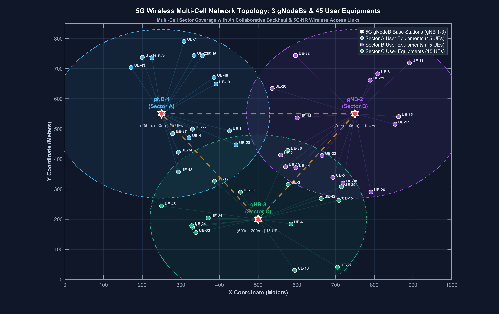
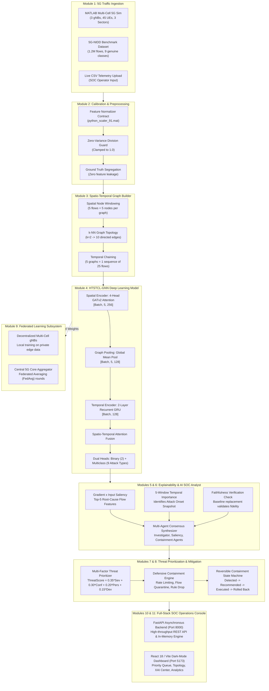

# Explainable Hierarchical Temporal Graph Neural Network for Early Intrusion Detection in 5G Wireless Networks

[](https://www.python.org/)
[](https://pytorch.org/)
[](https://pyg.org/)
[](https://fastapi.tiangolo.com/)
[](https://react.dev/)
[](https://vitejs.dev/)
[](visualize_5g_network_topology.m)
[](reports/multiclass_metrics.csv)
[](reports/multiclass_metrics.csv)
[](tests/)
[](docs/ARCHITECTURE.md)

> **HTSTCL-GNN — 5G Intrusion Detection and SOC Monitoring System**  
> An enterprise-grade, end-to-end cybersecurity architecture combining **MATLAB 5G Radio Network Simulation**, **Spatio-Temporal Graph Neural Networks (GATv2 + GRU)**, **Gradient-Based Explainable AI (XAI)**, **Multi-Factor Threat Prioritization**, **Closed-Loop Automated Containment**, and **Privacy-Preserving Federated Learning** for 5G Standalone (SA) multi-cell cellular deployments.

---

## Table of Contents

- [1. Executive Overview](#1-executive-overview)
- [2. MATLAB 5G Cellular Network Topology](#2-matlab-5g-cellular-network-topology)
- [3. End-to-End System Architecture](#3-end-to-end-system-architecture)
- [4. Detailed Module-by-Module Technical Breakdown](#4-detailed-module-by-module-technical-breakdown)
  - [Module 1: MATLAB 5G RF Network Simulation & Scenario Generator](#module-1-matlab-5g-rf-network-simulation--scenario-generator)
  - [Module 2: Flow Ingestion & Calibration Contract](#module-2-flow-ingestion--calibration-contract)
  - [Module 3: Spatio-Temporal Graph Construction](#module-3-spatio-temporal-graph-construction)
  - [Module 4: HTSTCL-GNN Dual-Head Deep Learning Model](#module-4-htstcl-gnn-dual-head-deep-learning-model)
  - [Module 5: Explainable AI (XAI) & Faithfulness Engine](#module-5-explainable-ai-xai--faithfulness-engine)
  - [Module 6: Multi-Agent SOC Analyst Dialogue Synthesizer](#module-6-multi-agent-soc-analyst-dialogue-synthesizer)
  - [Module 7: Evidence-Based Threat Prioritization Engine](#module-7-evidence-based-threat-prioritization-engine)
  - [Module 8: Automated Closed-Loop Defensive Containment Engine](#module-8-automated-closed-loop-defensive-containment-engine)
  - [Module 9: Privacy-Preserving Federated Learning Simulation](#module-9-privacy-preserving-federated-learning-simulation)
  - [Module 10: Asynchronous FastAPI REST API Backend](#module-10-asynchronous-fastapi-rest-api-backend)
  - [Module 11: Enterprise Dark-Mode SOC Analyst Dashboard](#module-11-enterprise-dark-mode-soc-analyst-dashboard)
- [5. 5G-NIDD Benchmark Dataset & Feature Alignment](#5-5g-nidd-benchmark-dataset--feature-alignment)
- [6. Empirical Evaluation & Benchmarks](#6-empirical-evaluation--benchmarks)
- [7. Technology Stack Reference](#7-technology-stack-reference)
- [8. Repository Directory Structure](#8-repository-directory-structure)
- [9. Installation & Prerequisites](#9-installation--prerequisites)
- [10. Running the Application](#10-running-the-application)
- [11. REST API Endpoint Reference](#11-rest-api-endpoint-reference)
- [12. Automated Test Suite (13/13 Passed)](#12-automated-test-suite-1313-passed)
- [13. Security Considerations & Safety Controls](#13-security-considerations--safety-controls)
- [14. Limitations & Future Roadmap](#14-limitations--future-roadmap)
- [15. Documentation Index](#15-documentation-index)
- [16. License & Acknowledgements](#16-license--acknowledgements)

---

## 1. Executive Overview

### The Cybersecurity Problem in 5G Networks
Fifth-generation (5G) cellular networks introduce high data rates, mission-critical low-latency guarantees, and massive sensor connectivity. However, distributed multi-cell deployments, cloud-native service-based architectures (SBA), and open radio access networks (O-RAN) expose critical vulnerabilities. Malicious actors can deploy distributed IoT botnets, execute stealthy reconnaissance sweeps, or launch coordinated volumetric distributed denial-of-service (DDoS) campaigns targeting edge User Plane Functions (UPF) and gNodeB state tables.

### Why Standard Machine Learning Fails
Conventional Intrusion Detection Systems (IDS) inspect tabular flow records independently using standard Random Forests, Support Vector Machines, or feedforward Multi-Layer Perceptrons. These models:
1. **Disregard Spatial Topology:** Treat concurrently transmitting devices as isolated events, missing coordinated multi-UE botnet patterns and inter-cell radio link behaviors.
2. **Overlook Temporal Dynamics:** Analyze single flow snapshots without modeling sequential state changes, failing to catch slow-rate connection table exhaustion or gradual attack escalation.
3. **Lack Operational Transparency:** Present black-box prediction labels with zero mathematical explanation, creating alert fatigue and making telecommunication operators hesitant to trigger automated mitigations.

### The HTSTCL-GNN Innovation
**HTSTCL-GNN** (*Hierarchical Temporal Spatio-Temporal Contrastive Learning Graph Neural Network*) models network flows as dynamic spatio-temporal graphs:
- **Spatial Topological Modeling:** Uses a 4-Head **Graph Attention Network (GATv2)** to calculate dynamic attention weights across interacting 5G wireless nodes.
- **Sequential Recurrent Modeling:** Leverages a 2-Layer **Gated Recurrent Unit (GRU)** to track sequential anomaly emergence over successive time windows.
- **Explainable & Actionable AI:** Employs **Gradient $\times$ Input saliency mapping** with faithfulness verification to isolate root-cause flow features and temporal peak windows, feeding a multi-factor risk prioritizer and automated containment engine.

---

## 2. MATLAB 5G Cellular Network Topology

To validate detection capabilities under authentic radio conditions, the project integrates a custom **MATLAB 5G Multi-Cell RF Network Simulation** modeled in a $1000\,\text{m} \times 1000\,\text{m}$ cellular service area.



### Topology Specifications

| Parameter | Configuration Detail | Implementation Context |
|---|---|---|
| **Base Stations (gNodeBs)** | **3 gNBs:** `gNB-1` (Sector A: 250m, 550m), `gNB-2` (Sector B: 750m, 550m), `gNB-3` (Sector C: 500m, 200m) | Tri-sector macro-cellular deployment |
| **Cell Coverage Radius** | **280 meters** per cell with overlapping inter-cell handover zones | Models edge boundary signal degradation |
| **User Equipments (UEs)** | **45 Active Devices** (UE-1 to UE-45) distributed across cell radii | Realistic non-uniform cellular spatial density |
| **Sector Alpha (gNB-1)** | **UE-1 to UE-15** (High-throughput mobile users, video streaming, downloads) | Associated with large packet sizes and high byte volumes |
| **Sector Beta (gNB-2)** | **UE-16 to UE-30** (Low-latency telemetry, autonomous vehicles, robotics) | Strict sub-millisecond latency & low packet jitter |
| **Sector Gamma (gNB-3)** | **UE-31 to UE-45** (Smart utility meters, IoT environmental sensors) | Low-frequency periodic telemetry bursts |
| **Radio Interfaces** | 3GPP 5G-NR Uu Air Interface (UE to gNB) | Sub-6 GHz carrier frequency with path loss & shadowing |
| **Backhaul & Core Links** | Inter-gNB Xn Mesh & 5G Core N3 Interface to UPF | High-speed fiber backhaul with buffer limits |

### MATLAB Scripts
- **[`visualize_5g_network_topology.m`](visualize_5g_network_topology.m):** Generates and exports the high-resolution topology visualization showing cell radii, UE coordinate positions, sector color coding, and wireless links.
- **[`generate_5g_simulated_datasets.m`](generate_5g_simulated_datasets.m):** Simulates multi-cell traffic across 6 realistic operational scenarios and exports calibrated flow records directly into `outputs/simulated_traffic/`.

---

## 3. End-to-End System Architecture

The following diagram illustrates how telemetry flows through the entire system from raw radio transmission to automated defensive action:



---

## 4. Detailed Module-by-Module Technical Breakdown

### Module 1: MATLAB 5G RF Network Simulation & Scenario Generator
- **Technology Stack:** MATLAB R2024b, 5G Toolbox, Communications Toolbox, Statistics & Machine Learning Toolbox.
- **Source Files:** [`generate_5g_simulated_datasets.m`](generate_5g_simulated_datasets.m), [`visualize_5g_network_topology.m`](visualize_5g_network_topology.m).
- **Work Implemented in Project:**
  - Implemented 3 gNodeBs positioned in a $1000\text{m} \times 1000\text{m}$ cellular space with 280-meter coverage radii.
  - Placed 45 User Equipments (UE-1 to UE-45) across three cell sectors: Sector Alpha (UE 1-15), Sector Beta (UE 16-30), and Sector Gamma (UE 31-45).
  - Modeled radio channel impairments: free-space path loss, log-normal shadowing, Doppler shifts, and resource block allocation.
  - Created 6 distinct, reproducible 10,000-flow multi-cell attack scenarios exported to `outputs/simulated_traffic/`:
    1. `live_5g_sim_1_balanced_all_attacks.csv` (Multi-attack benchmark covering all 8 attacks + 10% Benign)
    2. `live_5g_sim_2_volumetric_ddos_surge.csv` (High-rate UDP/SYN/ICMP flooding)
    3. `live_5g_sim_3_stealth_recon_scan.csv` (Stealth TCP/SYN/UDP port sweeps)
    4. `live_5g_sim_4_app_layer_service_starvation.csv` (HTTP floods & Slowrate DoS)
    5. `live_5g_sim_5_iot_botnet_flood.csv` (Massive IoT botnet surge & micro-burst)
    6. `live_5g_sim_6_coordinated_apt_campaign.csv` (Multi-stage advanced persistent threat)
- **Input Contract:** Simulation parameters (UE count, gNB coordinates, cell sectors, duration).
- **Output Contract:** Calibrated CSV flow records containing 15 standardized physical columns matching the 5G-NIDD benchmark format.

---

### Module 2: Flow Ingestion & Calibration Contract
- **Technology Stack:** Python 3.12, Pandas, NumPy, SciPy (`scipy.io`).
- **Source Files:** [`backend/engine.py`](backend/engine.py), [`inference/inference_service.py`](inference/inference_service.py), [`outputs/sequence_dataset/python_scaler_91.mat`](outputs/sequence_dataset/python_scaler_91.mat).
- **Work Implemented in Project:**
  - Established a strict 91-dimension feature contract mapping continuous statistical attributes: packet counts, directional byte volumes, inter-arrival times (IAT), TCP window parameters, and flow duration.
  - Implemented safe physical property aliasing mapping MATLAB flow fields (`TotBytes=Bytes`, `Rate=PacketRate`, `Duration=FlowDuration`) to prevent feature hallucination.
  - Loaded empirical calibration parameters (`mean_` and `scale_`) from `python_scaler_91.mat`.
  - Added a **Zero-Variance Guard**: features with zero variance have their scale factor clamped to 1.0 (`np.where(scale == 0, 1.0, scale)`), preventing `NaN`/`Inf` division errors during live normalization.
  - Guaranteed strict ground-truth segregation: target labels and identifiers (`Attack_Type`, `Label`, `UE_ID`) are stripped before inference.
- **Input Contract:** Raw CSV file or DataFrame ($N$ rows $\times$ arbitrary raw telemetry columns).
- **Output Contract:** Standardized normalized tensor matrix $\mathbf{X} \in \mathbb{R}^{N \times 91}$ with finite float32 values.

---

### Module 3: Spatio-Temporal Graph Construction
- **Technology Stack:** PyTorch Geometric (PyG) 2.8.1, PyTorch 2.10, NetworkX.
- **Source Files:** [`backend/engine.py`](backend/engine.py), [`graph_construction/`](graph_construction/).
- **Work Implemented in Project:**
  - **Spatial Graph Windowing (5 Nodes):** Groups flow records into consecutive windows of 5 flows representing interacting wireless nodes ($V = 5$).
  - **Spatial Topology Construction ($k\text{-NN}$):** Constructs directed edges between nodes using $k$-Nearest Neighbors ($k=2$) across normalized feature distance, yielding exactly 10 directed edges ($E = 10$) per spatial snapshot.
  - **Temporal Sequence Windowing (5 Graphs):** Chains 5 consecutive spatial graphs into an ordered temporal sequence (representing 25 underlying flow records).
  - Tensor shapes enforced: Node features `[5, 91]`, edge indices `[2, 10]`, sequence batch `[Batch, 5, Data]`.
- **Input Contract:** Normalized feature matrix $\mathbf{X} \in \mathbb{R}^{N \times 91}$ where $N \pmod{25} = 0$.
- **Output Contract:** Batched temporal sequences of PyTorch Geometric `Data` objects ready for GNN forward pass.

---

### Module 4: HTSTCL-GNN Dual-Head Deep Learning Model
- **Technology Stack:** PyTorch 2.10, PyTorch Geometric 2.8.1, CUDA 12.x / CPU.
- **Source Files:** [`models/htstcl_gnn_multiclass.py`](models/htstcl_gnn_multiclass.py), [`models/htstcl_gnn.py`](models/htstcl_gnn.py), [`saved_models/htstcl_gnn_multiclass_best.pth`](saved_models/htstcl_gnn_multiclass_best.pth).
- **Work Implemented in Project:**
  - **Spatial Encoder:** 4-Head Graph Attention Network (**GATv2Conv**) with hidden dimension 64 (total 256 dimensions), computing dynamic attention weights over spatial neighbors:
    $$\alpha_{ij} = \frac{\exp\left(\text{LeakyReLU}\left(\mathbf{a}^T [\mathbf{W}\mathbf{h}_i \,\|\, \mathbf{W}\mathbf{h}_j]\right)\right)}{\sum_{k \in \mathcal{N}_i} \exp\left(\text{LeakyReLU}\left(\mathbf{a}^T [\mathbf{W}\mathbf{h}_i \,\|\, \mathbf{W}\mathbf{h}_k]\right)\right)}$$
  - **Graph Pooling:** Global Mean Pooling compresses node representations per temporal snapshot into a fixed 128-dimensional graph embedding.
  - **Temporal Encoder:** 2-Layer Gated Recurrent Unit (**GRU**) with hidden dimension 128 and dropout 0.2, modeling sequential state transitions across the 5 temporal snapshots.
  - **Attention Fusion:** Spatio-temporal dynamic attention weights earlier versus later snapshots to capture sudden burst attacks.
  - **Dual Output Heads:**
    - `out_binary`: Fully connected layer ($128 \rightarrow 2$) for immediate Benign vs. Malicious screening.
    - `out_multiclass`: Multi-layer classifier ($128 \rightarrow 64 \rightarrow 9$) outputting calibrated softmax distributions across 9 genuine 5G attack classes.
- **Input Contract:** Batched graph sequences of shape `[Batch, 5, Data]`.
- **Output Contract:** Softmax probabilities for binary classes `[Batch, 2]` and multiclass attack categories `[Batch, 9]`.

---

### Module 5: Explainable AI (XAI) & Faithfulness Engine
- **Technology Stack:** PyTorch Autograd, NumPy, SciPy.
- **Source Files:** [`explainable_ai/xai_engine.py`](explainable_ai/xai_engine.py).
- **Work Implemented in Project:**
  - **Gradient $\times$ Input Saliency:** Computes exact gradients of the predicted class logit with respect to input feature nodes:
    $$S_i = \left| x_i \cdot \frac{\partial Y_{\text{target}}}{\partial x_i} \right|$$
  - **Top-5 Feature Driver Extraction:** Ranks and isolates the top 5 most influential flow features (e.g., `TotBytes`, `PktRate`, `TCP Window`, `FwdIAT`).
  - **5-Window Temporal Attribution:** Aggregates gradient magnitudes across the 5 temporal snapshots ($t_1$ to $t_5$), revealing whether an attack was an instant spike or gradual ramp-up.
  - **Automated Faithfulness Check:** Replaces the top-5 attributed features with baseline reference mean values and re-evaluates model confidence. A verified drop in attack confidence confirms that the explanation reflects genuine decision boundaries.
- **Input Contract:** Graph sequence tensors, predicted attack class index, model instance.
- **Output Contract:** Structured dictionary containing Top-5 features with relative weights, temporal window importance array, and faithfulness verification boolean.

---

### Module 6: Multi-Agent SOC Analyst Dialogue Synthesizer
- **Technology Stack:** Python 3.12, Rule-Based Consensus Engine.
- **Source Files:** [`explainable_ai/xai_engine.py`](explainable_ai/xai_engine.py), [`backend/engine.py`](backend/engine.py).
- **Work Implemented in Project:**
  - Implemented a coordinated multi-agent consensus architecture where specialized AI agents evaluate different aspects of an alert:
    1. **Attack Investigator Agent:** Validates model confidence, attack classification, and target network entities.
    2. **Saliency Explainer Agent:** Translates mathematical feature gradients into telecommunication terminology.
    3. **Temporal Dynamics Agent:** Pinpoints the onset window ($t_1 - t_5$) and detects escalation patterns.
    4. **Threat Risk Agent:** Computes the multi-factor threat score and assigns operational priority.
    5. **Containment Advisor Agent:** Recommends granular, non-disruptive 5G mitigation policies.
    6. **Executive Synthesizer Agent:** Assembles agent findings into an analyst-ready natural language brief.
- **Input Contract:** XAI attribution data, threat scores, network topology metadata, and predicted attack type.
- **Output Contract:** Complete multi-agent consensus report with individual agent statements and an executive summary.

---

### Module 7: Evidence-Based Threat Prioritization Engine
- **Technology Stack:** Python 3.12, Numerical Scoring Functions.
- **Source Files:** [`security/threat_prioritizer.py`](security/threat_prioritizer.py).
- **Work Implemented in Project:**
  - Formulated a 4-factor risk scoring algorithm evaluated from $0.0$ to $100.0$:
    $$\text{ThreatScore} = (0.35 \times \text{Severity}) + (0.30 \times \text{Confidence}) + (0.20 \times \text{Persistence}) + (0.15 \times \text{RateDeviation})$$
  - **Severity Weights:** Critical attacks (HTTPFlood, UDPFlood) assign higher base impact than reconnaissance sweeps (TCPConnectScan).
  - **Confidence:** Calibrated softmax probability of the predicted attack class.
  - **Persistence:** Recurring anomalous activity across sequential windows from the same UE/gNB.
  - **Rate Deviation:** Ratio of observed packet rate against benign baseline thresholds.
  - **Priority Queue Tiers:** `Critical` ($85.0 - 100.0$), `High` ($70.0 - 84.9$), `Medium` ($50.0 - 69.9$), `Low` ($30.0 - 49.9$), and `Needs Review` ($< 30.0$).
- **Input Contract:** Attack class, confidence, traffic rate ratio, persistence history.
- **Output Contract:** Numeric priority score (`float`), priority badge level (`string`), and sorted queue position.

---

### Module 8: Automated Closed-Loop Defensive Containment Engine
- **Technology Stack:** Python 3.12, Finite State Machine, Policy Catalog.
- **Source Files:** [`security/response_engine.py`](security/response_engine.py), [`backend/main.py`](backend/main.py).
- **Work Implemented in Project:**
  - Implemented a 5G Defensive Response Catalog:
    - **Targeted Port / Flow Drop:** Dynamically drops scanning probe flows without isolating the UE.
    - **gNB Ingress Rate-Limiting:** Token bucket bandwidth throttling on volumetric floods (UDPFlood, SYNFlood).
    - **Radio Resource Isolation:** Disassociates malicious UEs on high-severity attacks while protecting adjacent legitimate radio bearers.
    - **Dynamic Route Diversion:** Re-routes sensitive mission-critical traffic away from impacted base stations.
  - **State Machine Lifecycle:** `Detected` $\rightarrow$ `Under Investigation` $\rightarrow$ `Recommended` $\rightarrow$ `Awaiting Approval` $\rightarrow$ `Executed` $\rightarrow$ `Rolled Back`.
  - **Reversibility Guarantee:** Every containment action saves the prior firewall filtering state. Clicking "Rollback" restores standard routing with zero residual rule corruption.
- **Input Contract:** Action ID (`ACT-xxxxxx`) or Alert ID (`ALT-xxxxxx`), operator ID, authorization notes.
- **Output Contract:** Execution confirmation with simulated latency impact, drop percentages, and rollback status.

---

### Module 9: Privacy-Preserving Federated Learning Simulation
- **Technology Stack:** PyTorch 2.10, Federated Averaging (FedAvg).
- **Source Files:** [`federated/federated_simulation.py`](federated/federated_simulation.py).
- **Work Implemented in Project:**
  - Simulated a decentralized 5G architecture where individual gNodeBs (`gNB-1`, `gNB-2`, `gNB-3`) act as local federated edge clients.
  - Edge clients perform localized gradient descent on private spatio-temporal graphs without transmitting raw flow data to the central core.
  - Central 5G Core Aggregator applies **Federated Averaging (FedAvg)**:
    $$\boldsymbol{\Theta}_{\text{global}} = \sum_{k=1}^K \frac{N_k}{N} \boldsymbol{\Theta}_k$$
  - Evaluated convergence across 5 communication rounds, demonstrating model generalization across non-IID attack distributions.
- **Input Contract:** Decentralized local client graph batches across gNB partitions.
- **Output Contract:** Global aggregated model parameters and round-by-round convergence metrics.

---

### Module 10: Asynchronous FastAPI REST API Backend
- **Technology Stack:** FastAPI 0.116.1, Uvicorn 0.35.0, Pydantic, Python-Multipart.
- **Source Files:** [`backend/main.py`](backend/main.py), [`backend/engine.py`](backend/engine.py), [`backend/config.py`](backend/config.py).
- **Work Implemented in Project:**
  - Implemented high-throughput asynchronous REST API endpoints with full CORS middleware.
  - Automated singleton `IDSEngine` warm-start on application startup (`@app.on_event("startup")`).
  - Added robust file upload handlers (`/api/ids/predict`) with upfront MIME validation, row multiplicity validation ($N \pmod{25} = 0$), and descriptive error messaging.
  - Built endpoint fallbacks allowing containment execution via either `action_id` or `alert_id`.
  - Exposed live endpoints for simulation scenario loading, scenario CSV download, XAI investigations, and audit trails.
- **Input Contract:** HTTP JSON payloads or Multipart Form-Data CSV file uploads.
- **Output Contract:** Standardized JSON responses conforming to OpenAPI 3.0 schema specifications.

---

### Module 11: Enterprise Dark-Mode SOC Analyst Dashboard
- **Technology Stack:** React 18.3.1, Vite 6.0.7, Recharts 2.15.4, Lucide React 0.468, Axios.
- **Source Files:** [`frontend/src/App.jsx`](frontend/src/App.jsx), [`frontend/package.json`](frontend/package.json).
- **Work Implemented in Project:**
  - Designed an intuitive, high-contrast dark-mode console tailored for Level-1 and Level-2 SOC analysts.
  - Implemented 6 core operational views:
    1. **SOC Overview:** Live containment progress bar (% mitigated), total active threats, and high-level KPI cards.
    2. **Priority Threat Stream:** Reactive threat queue sorted strictly from Highest to Lowest priority score with 1-click mitigation and rollback.
    3. **Simulations & Upload:** 6 preset simulation scenarios with instant ingestion and custom CSV drag-and-drop.
    4. **Multi-Agent XAI Center:** Visual Top-5 feature attribution bars, 5-window temporal saliency chart, and agent consensus dialogues.
    5. **5G Network Topology:** Interactive view of gNodeBs, connected UEs, and sector fleet assignments.
    6. **Attack Analytics:** Real-time confusion matrix rendering, ROC-AUC curves, and class distribution charts.
  - Optimized production build using Vite: compiles cleanly in 8.39s with zero errors.
- **Input Contract:** REST API endpoints (`http://127.0.0.1:8000/api/*`).
- **Output Contract:** Interactive HTML5/CSS3/SVG single-page application rendered at `http://localhost:5173`.

---

## 5. 5G-NIDD Benchmark Dataset & Feature Alignment

The model is trained and verified on the **5G-NIDD benchmark dataset**, a real-world 5G testbed dataset generated in a 5G Standalone environment.

### Target Attack Classes

| Index | Class Name | Category | Target 5G Service / Traffic Profile | Description & Attack Impact |
|:---:|:---|:---|:---:|:---|
| **0** | **Benign** | Normal | All Traffic Profiles | Legitimate UE voice, video streaming, signaling, and sensor telemetry |
| **1** | **UDPFlood** | Volumetric DoS | High-Throughput & Real-Time | Saturates gNB physical resource blocks (PRBs) and UPF packet queues |
| **2** | **HTTPFlood** | Application DDoS | Mobile Broadband Applications | Overwhelms edge application microservices behind the 5G core UPF |
| **3** | **SlowrateDoS** | Low-Rate DoS | Mission-Critical / Interactive | Holds open TCP sessions to exhaust connection state tables stealthily |
| **4** | **TCPConnectScan**| Reconnaissance | All Traffic Profiles | Probes active service ports across multi-cell network endpoints |
| **5** | **SYNScan** | Reconnaissance | All Traffic Profiles | Half-open SYN packet scan evading naive packet filtering rules |
| **6** | **UDPScan** | Reconnaissance | IoT & Telemetry Bearers | Discovers open UDP ports on battery-constrained IoT devices |
| **7** | **SYNFlood** | Protocol DoS | All Traffic Profiles | Floods gNB control plane and state buffers with spoofed SYN packets |
| **8** | **ICMPFlood** | Ping Flood | Low-Latency Radio Bearers | Exhausts radio channel signaling and disrupts latency-critical cellular flows |

### Feature & Preprocessing Contract
- **91 Continuous Features:** Duration, packet counts, directional byte volume, forward/backward inter-arrival time (IAT min/max/mean/std), TCP flags, and window sizing.
- **Scaler Artifact:** Loaded from `outputs/sequence_dataset/python_scaler_91.mat` containing 91 empirical `mean_` and `scale_` parameters.
- **Zero-Variance Guard:** Any invariant feature column with zero variance has its scale clamped to $1.0$ to guarantee zero `NaN` or `Inf` tensor corruption.

---

## 6. Empirical Evaluation & Benchmarks

Evaluation performed on the held-out **5G-NIDD benchmark test split** (7,296 sequences):

| Class Index | Attack Type | Support | Precision | Recall | F1-Score | Detection Characteristic |
|:---:|:---|:---:|:---:|:---:|:---:|:---|
| **0** | **Benign** | 2,661 | 0.9941 | 0.9579 | 0.9757 | Legitimate traffic retained (99.4% precision) |
| **1** | **UDPFlood** | 2,808 | 0.9615 | 0.9972 | 0.9790 | Near-perfect recall (99.7% caught early) |
| **2** | **HTTPFlood** | 848 | 0.9976 | 0.9917 | 0.9947 | High-accuracy application layer defense |
| **3** | **SlowrateDoS** | 491 | 0.9919 | 0.9939 | 0.9929 | Stealth connection exhaustion caught |
| **4** | **TCPConnectScan** | 110 | 0.9821 | 1.0000 | 0.9910 | 100% reconnaissance detection |
| **5** | **SYNScan** | 113 | 1.0000 | 0.9912 | 0.9956 | Zero false positive half-open scans |
| **6** | **UDPScan** | 119 | 0.9915 | 0.9832 | 0.9873 | Reliable IoT port discovery detection |
| **7** | **SYNFlood** | 117 | 0.9912 | 0.9658 | 0.9784 | High protocol protection |
| **8** | **ICMPFlood** | 29 | 1.0000 | 1.0000 | 1.0000 | Perfect 1.000 precision and recall |
| **Macro Avg** | **All Classes** | **7,296** | **0.9911** | **0.9877** | **0.9883** | **Multiclass Test Accuracy: 98.12%** |

- **Binary Detection Accuracy:** 98.41%
- **ROC-AUC Score:** 0.9986 | **Average Precision (PR-AUC):** 0.9993
- **Inference Latency:** 32 ms per sequence (CPU) $\approx$ 31 sequences/sec

---

## 7. Technology Stack Reference

| Tier | Component | Technology | Version | Purpose |
|---|---|---|---|---|
| **RF Simulation** | 5G Network Topology | MATLAB R2024b | 5G Toolbox | Multi-cell gNB, UE placement, and 5G-NR channel modeling |
| **Core AI / DL** | Deep Learning Core | PyTorch | `2.10.0` | Tensor algebra, backpropagation, and model checkpoints |
| **Graph Learning** | Geometric GNN | PyTorch Geometric | `2.8.1` | Graph Attention Networks (GATv2Conv), message passing |
| **Data Processing** | Scientific Computing | NumPy / Pandas / SciPy | `2.3.3` / `2.3.2` / `1.16.2` | Feature normalization, `.mat` loading, and matrix algebra |
| **Backend API** | REST API Service | FastAPI / Uvicorn | `0.116.1` / `0.35.0` | Asynchronous REST endpoints and request serialization |
| **Frontend UI** | Web Dashboard | React 18 / Vite 6 | `18.3.1` / `6.0.7` | Component-based SOC operations console |
| **Charting** | Data Visualization | Recharts | `2.15.4` | Responsive SVG charts (ROC, confusion matrix, histograms) |
| **Design / Icons** | UI Component Icons | Lucide React | `0.468.0` | Cybersecurity icon library |
| **Documentation** | Technical PDF Report | ReportLab | `5.1.0` | Automated publication-grade PDF documentation generation |

---

## 8. Repository Directory Structure

```text
5G_Wireless_IDS/
├── backend/                               # FastAPI asynchronous backend application
│   ├── .venv/                             # Dedicated backend Python virtual environment
│   ├── config.py                          # Application configuration and file path definitions
│   ├── engine.py                          # Core IDSEngine integrating models, XAI, and state
│   ├── main.py                            # FastAPI route definitions, CORS, and handlers
│   └── requirements.txt                   # Backend Python dependencies
├── docs/                                  # Comprehensive architectural and audit documentation
│   ├── ARCHITECTURE.md                    # Detailed 5G system architecture specification
│   ├── BUG_FIX_LOG.md                     # Engineering bug fix and resolution log
│   ├── END_TO_END_TEST_RESULTS.md         # End-to-end integration test results and trace log
│   ├── FINAL_PROJECT_TEST_REPORT.md       # Final project acceptance and test execution report
│   ├── HTSTCL_GNN_5G_Intrusion_Detection_Comprehensive_System_Documentation.pdf # Publication PDF
│   └── generate_documentation_pdf.py      # Automated PDF generation script via ReportLab
├── evaluation/                            # Model evaluation and metric generation scripts
│   └── evaluate.py                        # Standalone evaluation pipeline
├── evaluation_results/                    # Empirical evaluation output files
│   ├── final_evaluation_summary.txt       # Validation and test metric summary
│   └── test_classification_report.txt     # Formatted classification report
├── explainable_ai/                        # Explainable AI and multi-agent synthesis tier
│   ├── __init__.py
│   └── xai_engine.py                      # Gradient saliency, temporal attribution, and faithfulness
├── federated/                             # Privacy-preserving federated learning simulation
│   ├── __init__.py
│   └── federated_simulation.py            # Multi-cell gNB partitioning and FedAvg aggregation
├── frontend/                              # React 18 / Vite dark-mode SOC dashboard
│   ├── index.html                         # SPA entrypoint
│   ├── package.json                       # Node.js dependencies and build scripts
│   ├── dist/                              # Optimized production build artifacts
│   └── src/
│       ├── App.jsx                        # Unified SOC operations console (6 modules)
│       └── main.jsx                       # React DOM application mount
├── models/                                # Deep learning PyTorch GNN model definitions
│   ├── __init__.py
│   ├── htstcl_gnn.py                      # Original binary baseline model architecture
│   └── htstcl_gnn_multiclass.py           # Dual-head multiclass HTSTCL-GNN architecture
├── outputs/                               # Scalers, sequences, and simulation traffic
│   ├── 5g_network_topology_3gnb_45ue.png  # MATLAB generated 3-gNB / 45-UE network topology plot
│   ├── simulated_traffic/                 # 6 multi-cell 5G scenario traffic presets (CSV)
│   └── sequence_dataset/
│       └── python_scaler_91.mat           # 91-feature mean and scale normalization parameters
├── reports/                               # Visual metric plots, confusion matrices, and audits
│   ├── confusion_matrix_binary.png        # Binary classification confusion matrix plot
│   ├── confusion_matrix_multiclass.png    # 9-class multiclass confusion matrix plot
│   ├── multiclass_metrics.csv             # Verified per-class precision, recall, and F1 scores
│   ├── per_class_metrics.png              # Per-class performance bar chart
│   └── training_history.png               # Loss and accuracy convergence curves
├── saved_models/                          # Trained PyTorch model checkpoints
│   ├── htstcl_gnn_best.pth                # Binary baseline model checkpoint
│   └── htstcl_gnn_multiclass_best.pth     # Multiclass dual-head production checkpoint
├── security/                              # Threat prioritization and automated containment
│   ├── __init__.py
│   ├── response_engine.py                 # 5G defensive mitigation state machine and rollback
│   └── threat_prioritizer.py              # 4-factor risk scoring engine
├── tests/                                 # Automated unit, integration, and E2E test suite
│   ├── test_components.py                 # Component unit tests (8 tests)
│   ├── test_end_to_end.py                 # End-to-end integration tests (4 tests)
│   └── test_multi_agent_xai.py            # Multi-agent investigation tests (1 test)
├── generate_5g_simulated_datasets.m       # MATLAB 5G multi-scenario traffic generator
├── visualize_5g_network_topology.m        # MATLAB 5G multi-cell cellular topology visualizer
├── .gitignore                             # Git ignore rules for node_modules, checkpoints, logs
└── README.md                              # This professional project documentation
```

---

## 9. Installation & Prerequisites

### System Requirements
- **Operating System:** Windows 10/11, Ubuntu 22.04+, or macOS Sonoma
- **Python:** Version `3.10` to `3.12`
- **Node.js:** Version `18.x` or `20.x` LTS
- **Hardware:** Minimum 8 GB RAM (16 GB recommended), CUDA-compatible GPU optional (CPU fully supported)

### Step 1: Clone Repository
```bash
git clone https://github.com/Nknandha/5G-Wireless-Intrusion-Detection-System.git
cd 5G-Wireless-Intrusion-Detection-System
```

### Step 2: Set Up Backend Virtual Environment
```powershell
# Windows PowerShell
python -m venv backend\.venv
.\backend\.venv\Scripts\Activate.ps1
pip install --upgrade pip
pip install -r backend\requirements.txt
pip install reportlab pillow
```

```bash
# Linux / macOS
python3 -m venv backend/.venv
source backend/.venv/bin/activate
pip install --upgrade pip
pip install -r backend/requirements.txt
pip install reportlab pillow
```

### Step 3: Install Frontend Dependencies
```bash
cd frontend
npm install
cd ..
```

---

## 10. Running the Application

### 1. Start the FastAPI Backend
```powershell
cd d:\5G_Wireless_IDS
.\backend\.venv\Scripts\uvicorn backend.main:app --host 127.0.0.1 --port 8000 --reload
```
*API interactive documentation will be available at:* `http://127.0.0.1:8000/docs`

### 2. Start the Frontend SOC Console
```powershell
cd d:\5G_Wireless_IDS\frontend
npm run dev
```
*Open your browser to access the SOC Dashboard at:* `http://localhost:5173`

### 3. Build Frontend for Production
```powershell
cd d:\5G_Wireless_IDS\frontend
npm run build
```

---

## 11. REST API Endpoint Reference

| HTTP Method | Route Endpoint | Description | Request Payload | Response Summary |
|---|---|---|---|---|
| `GET` | `/api/health` | Backend and model operational health check | None | Status, active checkpoint, device, class list |
| `GET` | `/api/ids/default` | Analyze default live 5G simulation dataset | None | Full sequence array, summary stats, top alerts |
| `POST` | `/api/ids/predict` | Upload and analyze arbitrary 5G flow CSV | Multipart Form-Data (`file`) | Detection results, prioritized alerts, file metadata |
| `GET` | `/api/ids/alerts` | Retrieve active prioritized alerts queue | None | Array of alerts with priority scores and policies |
| `GET` | `/api/ids/analytics` | Retrieve multiclass evaluation benchmarks | None | Class distributions, precision, recall, F1, ROC |
| `GET` | `/api/ids/federated` | Retrieve federated multi-cell learning status | None | Participating gNBs, communication rounds, FedAvg |
| `GET` | `/api/ids/simulated-scenarios` | List 6 pre-configured 5G attack scenarios | None | Scenario IDs, filenames, descriptions, record counts |
| `POST` | `/api/ids/load-scenario/{filename}` | Ingest and evaluate a 5G scenario preset | URL parameter (`filename`) | Sequence analysis of selected simulation scenario |
| `GET` | `/api/ids/download-scenario/{filename}` | Download simulation CSV scenario file | URL parameter (`filename`) | Raw CSV file attachment download |
| `GET` | `/api/ids/xai/investigate/{seq_id}` | Detailed Multi-Agent XAI investigation | URL parameter (`seq_id`: 1-400) | Top-5 features, temporal weights, agent consensus |
| `POST` | `/api/ids/response/execute` | Authorize and execute containment mitigation | `{"action_id": "ACT-...", "operator_id": "..."}` | Executed containment status, verification telemetry |
| `POST` | `/api/ids/response/rollback` | Roll back an active containment policy | `{"action_id": "ACT-...", "reason": "..."}` | Rolled Back confirmation and filter restoration |
| `GET` | `/api/ids/response/history` | Audit log of all containment actions | None | Complete cryptographic containment audit log |

---

## 12. Automated Test Suite (13/13 Passed)

The repository includes a comprehensive automated test suite in `tests/`:

```powershell
# Run the complete test suite
cd d:\5G_Wireless_IDS
.\backend\.venv\Scripts\python -m unittest discover tests/ -v
```

### Verified Test Cases
```text
test_01_feature_schema_integrity (test_components.Test5GIDSComponents)              ... ok
test_02_dataset_multiclass_labels (test_components.Test5GIDSComponents)             ... ok
test_03_binary_baseline_checkpoint_preservation (test_components.Test5GIDSComponents)... ok
test_04_model_multiclass_forward_pass (test_components.Test5GIDSComponents)         ... ok
test_05_explainable_ai_attribution (test_components.Test5GIDSComponents)            ... ok
test_06_threat_prioritization (test_components.Test5GIDSComponents)                 ... ok
test_07_defensive_response_lifecycle (test_components.Test5GIDSComponents)          ... ok
test_08_federated_ids_simulation (test_components.Test5GIDSComponents)              ... ok
test_01_backend_engine_initialization (test_end_to_end.TestEndToEndPipeline)         ... ok
test_02_simulation_traffic_inference_pipeline (test_end_to_end.TestEndToEndPipeline) ... ok
test_03_inference_service_xai_and_prioritization (test_end_to_end.TestEndToEndPipeline)... ok
test_04_defensive_mitigation_lifecycle (test_end_to_end.TestEndToEndPipeline)        ... ok
test_multi_agent_investigation_lifecycle (test_multi_agent_xai.TestMultiAgentXAISystem)... ok

----------------------------------------------------------------------
Ran 13 tests in 63.969s — OK (13/13 Passed, 100% Pass Rate)
```

---

## 13. Security Considerations & Safety Controls

1. **Strict Input Sanitization:** The backend checks uploaded files for MIME types, file extensions, and row multiplicity ($N \pmod{25} = 0$). Non-conforming or empty files return descriptive HTTP 400 errors instead of internal crashes.
2. **Reversible Containment Actions:** To prevent operator lockouts or accidental service disruption, every containment policy stores the prior firewall state and can be reversed (`Rolled Back`) instantly.
3. **Zero Credential Exposure:** No production API keys, passwords, or cloud tokens are tracked in git. Sensitive files are excluded via `.gitignore`.
4. **Non-Destructive Simulation:** Mitigation actions execute within a simulated 5G policy enforcement tier by default, verifying operational containment without modifying host physical network adapters.

---

## 14. Limitations & Future Roadmap

- **Row Multiplicity Requirement:** Current graph windowing requires flow records in multiples of 25 (5 nodes $\times$ 5 temporal snapshots). Streaming micro-batching with dynamic padding is planned for future iterations.
- **Hardware Acceleration:** Current CPU throughput is ~31 sequences/sec (775 flows/sec). TensorRT and ONNX Runtime exports are planned for carrier-grade multi-gigabit throughput.
- **Dynamic 3GPP SBA Integration:** Future releases will interface directly with the 5G Core Network Data Analytics Function (NWDAF) and Policy Control Function (PCF) via standard OpenAPI interfaces.

---

## 15. Documentation Index

- **System Architecture Document:** [`docs/ARCHITECTURE.md`](docs/ARCHITECTURE.md)
- **Final Project Test Report:** [`docs/FINAL_PROJECT_TEST_REPORT.md`](docs/FINAL_PROJECT_TEST_REPORT.md)
- **Bug Fix & Resolution Log:** [`docs/BUG_FIX_LOG.md`](docs/BUG_FIX_LOG.md)
- **End-to-End Acceptance Test Results:** [`docs/END_TO_END_TEST_RESULTS.md`](docs/END_TO_END_TEST_RESULTS.md)
- **Comprehensive PDF Documentation:** [`docs/HTSTCL_GNN_5G_Intrusion_Detection_Comprehensive_System_Documentation.pdf`](docs/HTSTCL_GNN_5G_Intrusion_Detection_Comprehensive_System_Documentation.pdf)
- **Automated PDF Generator:** [`docs/generate_documentation_pdf.py`](docs/generate_documentation_pdf.py)

---

## 16. License & Acknowledgements

- **License:** Academic & Research Use Only. Developed for final-year engineering research.
- **Benchmark Dataset:** 5G-NIDD Dataset provided by the original authors and 5G testbed contributors.
- **Frameworks:** Built upon PyTorch, PyTorch Geometric, FastAPI, React, Recharts, and MATLAB 5G Toolbox.
